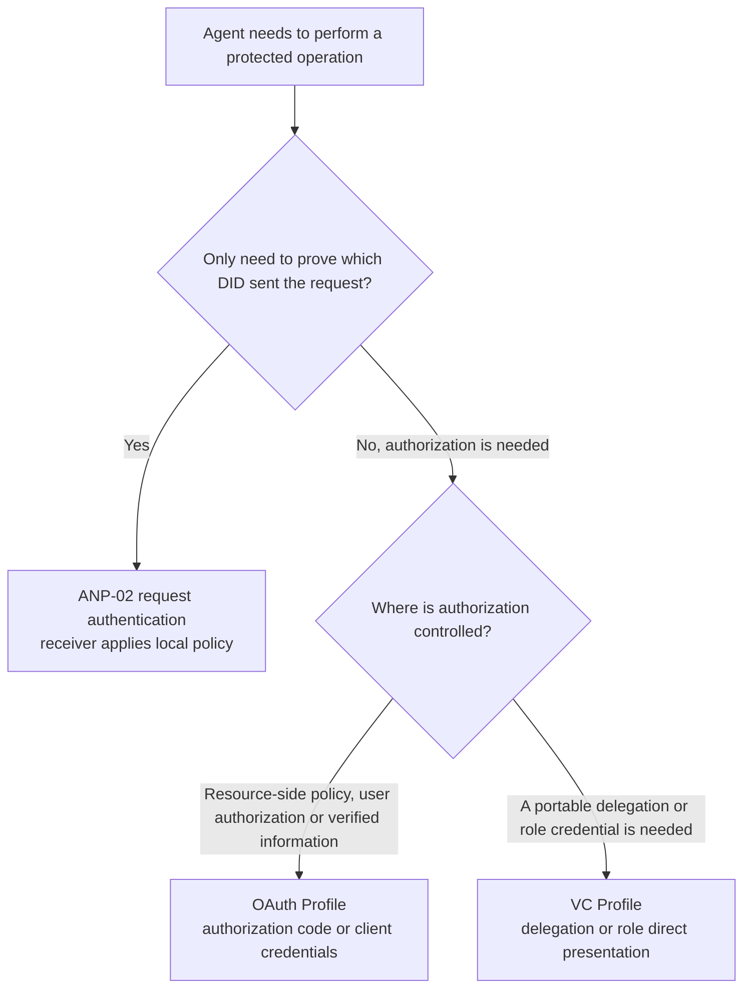
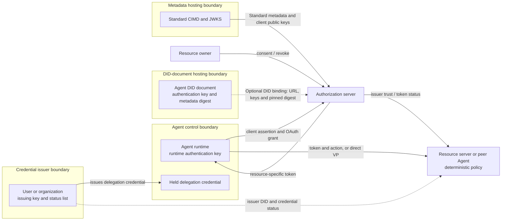
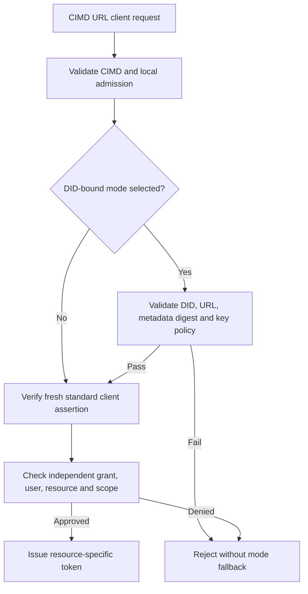
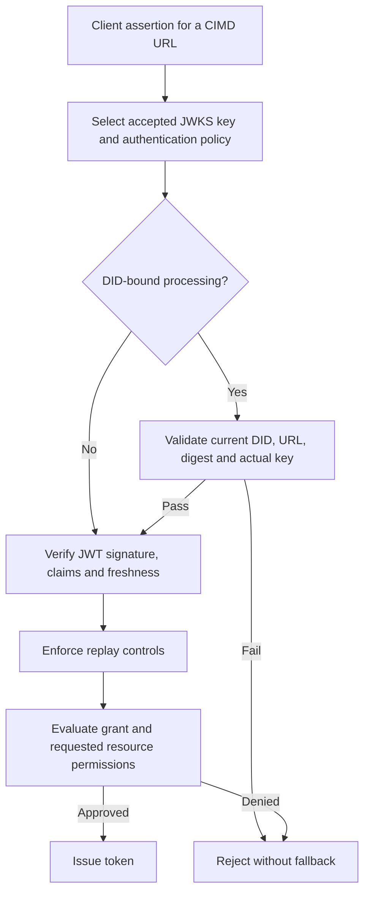
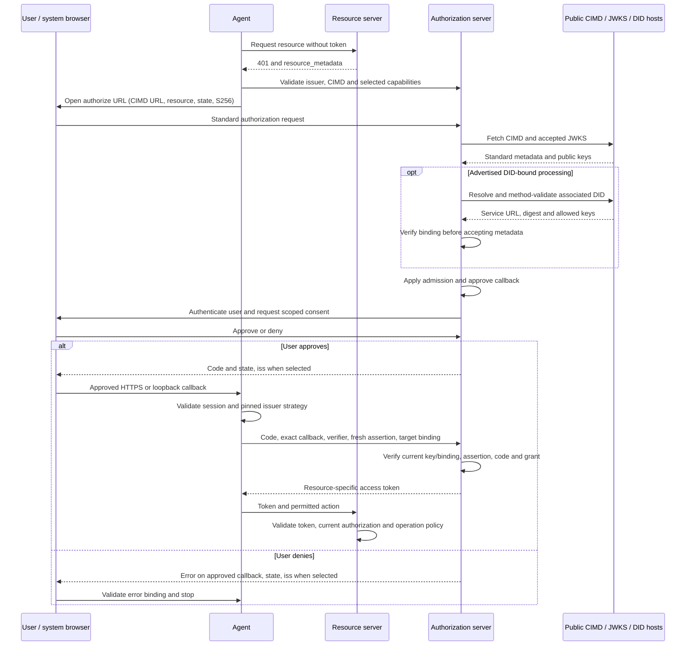
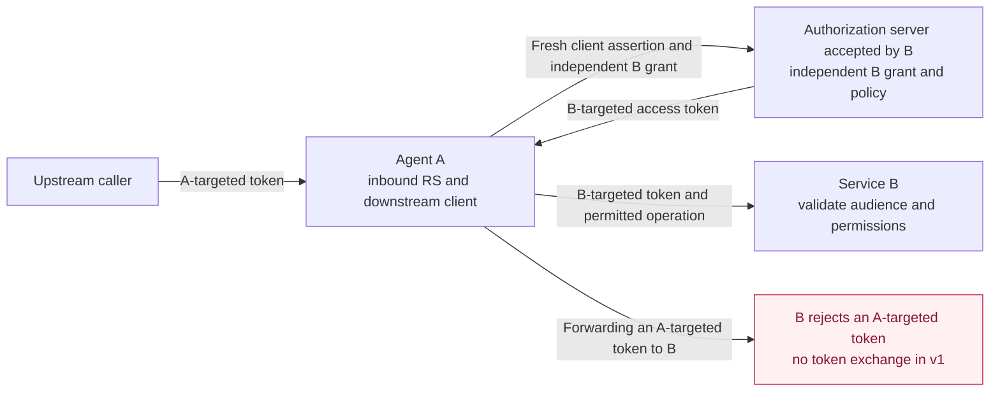
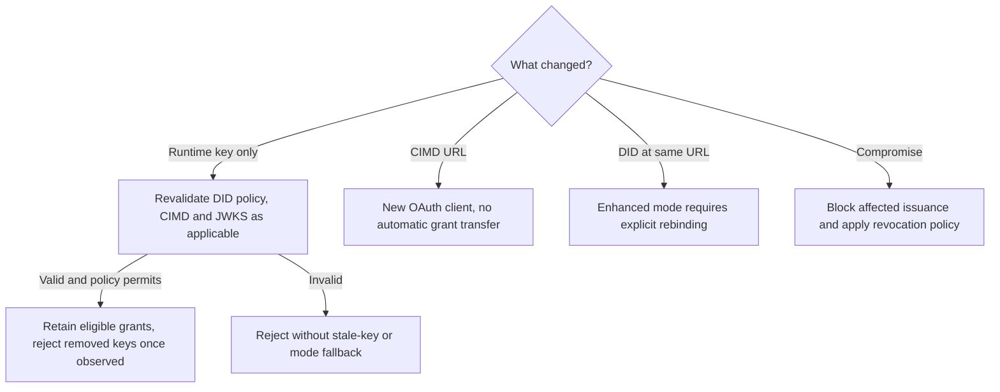

# ANP DID-Based Authorization Protocol

- Document ID: ANP-05
- Status: Draft / not released
- Version: 0.7
- Specification set: ANP vNext; not part of the ANP 1.2 release
- Draft Profile identifiers: OAuth Profile `anp.authorization.oauth2.cimd.v1-draft1`; VC Profile `anp.authorization.vc.v1-draft2`
- Language: English
- Chinese mirror: [ANP 基于 DID 的授权协议](chinese/05-ANP-基于DID的授权协议.md)

<a id="scope"></a>
## 1. Scope, authorization problem, and roadmap

ANP-05 defines the DID-based agent authorization workstream with two complementary mechanisms: the **OAuth Profile**, in which an authorization server trusted by the resource side issues access tokens, and the **VC Profile**, in which a user or organization that holds the authority issues a W3C Verifiable Credential (VC) that the Agent holds and presents. DID identifies principals at the ANP layer. In the OAuth path, an ordinary AS uses the URL client identifier and its own resource-owner identity; only an explicitly verified DID binding establishes the associated DID at that AS. The VC path identifies its issuer and authorized Agent by DID. **The first release (v1) is a DID–OAuth client identity and basic delegated-access Profile, plus directly presented single-level VC delegation and organization-role credentials, not a complete agent delegation system.** The current document is its unreleased v0.7 draft. In this document, “v1” names that first-release scope; it does not mean that v1 has shipped or that all later roadmap capabilities are implemented.

In the OAuth Profile, an Agent associates its DID with a standard OAuth Client ID Metadata Document (CIMD) HTTPS URL and uses a published authentication key to authenticate that URL client; the resource owner authorizes access, the authorization server (AS) issues a restricted token, and the resource server (RS) enforces it. That path does not require VC, VP, an OIDC login bridge, or a blockchain. In the VC Profile, a principal with authority issues a credential to an Agent. The Agent presents it through a holder-bound Verifiable Presentation (VP); the verifier independently validates the issuer, holder, credential status, permissions, constraints and local trust policy, then performs or rejects the requested operation.

The OAuth Profile's baseline is **OAuth 2.0 plus published extensions**, including RFC 6749 and RFC 9700, together with the explicitly pinned CIMD draft-02 for URL client identifiers and metadata discovery. CIMD is a work-in-progress dependency, not a published RFC. OAuth 2.1 draft-16 and JWT client-authentication update draft-11 are informative design references, not published RFC dependencies. The VC Profile's normative baseline is the W3C VC Data Model 2.0, VC Data Integrity 1.0 with its EdDSA cryptosuites, and Bitstring Status List 1.0. Capitalized MUST, MUST NOT, SHOULD, SHOULD NOT, and MAY use BCP 14 meanings. The restrictions below are this Profile's rules, not amendments to the referenced specifications.

**ANP-05 v1 defines two independent authorization paths: DID-backed OAuth for resource-side access authorization, and holder-bound VC presentation for portable delegation and organization-role credentials. V1 does not define conversion from VC/VP to OAuth access tokens. Standalone qualification or attribute credential profiles are not defined by this version.**

Document structure: Section 1 states the authorization problem and roadmap; Section 2 covers the relationship to ANP-02 and when to use OAuth or VC; Sections 3–10 define the OAuth Profile; Section 11 defines the VC Profile; Sections 12–14 are the shared error-handling, security and conformance requirements.

<a id="authorization-problem"></a>
### 1.1 The actual agent authorization problem (informative)

The central question is not only “which Agent holds this key?” but **“who authorized which Agent to perform which action, on which resource, under which limits, and how can that authority end?”** Five requirements drive the work:

| Requirement | Problem that must be solved | v1 boundary |
| --- | --- | --- |
| Human-to-Agent delegation | Record the authorizing user, intended Agent, resource, permitted actions, duration, and withdrawal; a natural-language task is not itself a resource grant. | OAuth: authorization code with user consent or valid existing authorization; distinct user and client subjects, scopes, expiry and revocation. VC: a user or organization issues a single-level delegation credential (Section 11) as a portable mandate: any verifier can check its signatures independently, but accepting it still requires a fresh status check; the verifier still decides authority independently. |
| Organization authorizing an Agent to act for it | A company appoints an Agent as its HR Agent or purchasing Agent to deal on the company's behalf with recruiting platforms, suppliers or peer Agents not known in advance; the counterparty must confirm that this Agent really represents the company, what it may do, and its limits. | VC: the organization issues a role credential (Section 11.2) listing functions and constraints by business action rather than by resource address; the counterparty confirms the issuer is that organization, maps the actions to its own operations, and decides whether to accept. No cross-counterparty cumulative budget and no automatic authority over third parties' personal data. |
| One Agent serving a user across multiple services | Each service controls its own resources, account identity and policy; permissions and consent at one service are not accepted everywhere. | OAuth: repeat the flow with the same Agent DID for each resource and accepted AS; keep independent grants and target-limited tokens. VC: one credential may list resources at several services; each verifier uses only its own entries and independently confirms the issuer's authority over them. No single global consent or cross-AS account equivalence. |
| Multi-level redelegation | A delegates to B and B to C without expanding authority or losing user/actor attribution; revocation and shared limits must propagate. | Not defined. The VC Profile accepts only credentials issued to the Agent directly by a principal the verifier independently recognizes; issuing authority cannot be derived from a delegation credential, role credential or access token the issuer itself holds, so a credential re-issued by an Agent holding someone else's delegation is rejected. No token, credential or private-key forwarding as implicit delegation. |
| Per-operation approval for high-risk actions | Bind a person's approval to the exact payee, amount/currency, data disclosure or deletion target, expiry and one-time operation identifier. | No generic transaction-approval credential. A delegation credential expresses a scope granted in advance and is not a per-operation approval either. A service requiring separate approval must verify its own explicit operation approval or block the action. Login, a broad scope, a DID signature, or DPoP alone is not that approval. |

A basic consent record and a VC delegation credential both already delegate limited access to an Agent. It is therefore inaccurate to say v1 does no human delegation at all. The VC delegation credential provides a portable mandate but covers single-level delegation only; v1 does **not** yet define delegation chains or standardized transaction approval. The user's instruction can guide execution but cannot create rights the user or Agent does not have.

<a id="technical-choices"></a>
### 1.2 Technical choices and implementation cost (informative)

**Reuse OAuth for the authorization lifecycle.** RFC 6749 already separates resource owner, client, AS and RS and supplies consent/grant, access-token and refresh flows. RFC 7523 Section 2.2 supplies the client assertion transport; RFC 7636, RFC 8707, RFC 7009 and RFC 7662 supply code protection, target restriction, revocation and status checks. This lets ANP focus on reusable Agent identity and the missing agent-specific delegation semantics, rather than invent another grant/token ecosystem. OAuth is not the whole solution: it does not by itself define a task-wide budget, permission attenuation, or a user's approval of a specific business action.

**Use DID as the principal, not as permission.** The same method-validated DID and selected authentication-key relationships can be reused for ordinary ANP authentication, communication and publication of OAuth client keys. In the standard CIMD mode, the AS authenticates the URL client; only a verifier performing the additional DID-binding checks can claim to have authenticated the associated DID. Native did:web retains DNS/HTTPS/hosting trust; it does not gain a fingerprint-bound identity or protection from its own DID-document host merely by using this Profile. Path-based did:wba e1_ adds binding-key fingerprints and a verified document proof. Those properties are conditional on correct method validation and key custody; neither method proves software integrity or human consent. This is a common identity/lifecycle model, not a claim that only DID can offer portable identifiers.

**Reuse CIMD to connect to the existing OAuth ecosystem.** The primary advantage is that an authorization server already supporting CIMD and the selected standard OAuth features can process the client without an ANP-specific change to its client identifier, metadata discovery, grant or token flow. The OAuth `client_id` remains the CIMD HTTPS URL; the DID document supplies an ANP identity association and the publisher exports selected authentication keys as standard JWKS. This places DID adaptation in the Agent SDK or metadata publisher instead of requiring a DID resolver at every AS. Compatibility is conditional on the AS's admission policy, supported authentication algorithms and selected flow; it does not imply that every OAuth server supports CIMD or that a standard CIMD server has verified a DID. Section 4 separates ordinary CIMD processing from optional, explicitly negotiated DID-binding verification. A future extension may explore using the DID itself as `client_id` (Section 16), with explicit AS support and migration rules. The private key stays with the Agent or its explicitly authorized signer.

**Use VC to carry authority that originates outside the resource side.** The basis for much agent authorization is not held by the resource side: a company appoints an Agent as its purchasing representative, a user gives an Agent a mandate it can show to several merchants, or an institution attests which organization an Agent belongs to or what qualification it has. An OAuth consent record lives inside each AS; it cannot be carried to another service or verified by a peer that has no AS. W3C VC 2.0 lets the authorizing party sign a statement under its own DID; the Agent holds it and presents it to any verifier that trusts that issuer. Verification only requires resolving the issuer and holder DIDs and checking a status list, with no prior integration between verifier and issuer. ANP already uses Data Integrity eddsa-jcs-2022 for did:wba document proofs and the messaging binding; the VC Profile reuses that proof mechanism rather than adding another signature stack. VC has costs too: revocation depends on a status list and has cache latency; each verifier must maintain its own policy on which issuers it trusts for which claims; and once presented, a credential's contents are visible to the verifier.

**VC and OAuth have separate roles and do not replace each other.** In v1 they are independent authorization paths. OAuth is used when authorization is managed by the resource side and represented through an OAuth grant and access token. The v1 VC Profile carries external delegation or organization-role credentials for independent verification; qualification or attribute credentials can only be supplementary evidence explicitly requested by the verifier under separately agreed rules. An OAuth authorization decision may also use roles, qualifications, organization identity or other verified information. A future extension may define how externally issued credentials can be used as input to an OAuth authorization decision; v1 does not define VC-to-access-token exchange. Section 2.2 explains when to choose which. Standards proposed for later phases are evaluation targets, not current conformance requirements.

<a id="v1-scope"></a>
### 1.3 What v1 delivers

V1's deliverable is **DID-associated OAuth client identity plus usable, auditable basic user delegation**: standard CIMD URL client identifiers; DID-to-CIMD discovery and public-key publication; optional integrity-checked DID binding; policy-controlled first-contact admission without per-AS preregistration where enabled; RFC 7523 client authentication; client credentials for qualified confidential deployments; authorization code with S256 PKCE for hosted HTTPS and local loopback clients; target-specific tokens, optional refresh, and lifecycle enforcement. A deployment claiming user-delegated support under the OAuth Profile MUST implement the authorization-code path; a client-credentials-only implementation MUST NOT claim OAuth user-delegation capability. A verifier that accepts delegation only through the VC Profile is not subject to this requirement.

For user-delegated grants, the AS MUST retain the authenticated resource-owner identifier in its issuer/tenant context, URL client identifier, associated Agent DID only when verified, target resource, granted scopes, approval source and time, applicable lifetime/revocation policy, and a stable internal grant reference. An existing consent or administrator grant may supply approval only under documented policy. This is an OAuth authorization-record requirement; the portable, cross-system mandate is defined by the VC Profile. New permissions require another approval decision. User credentials and an Agent's authentication key remain separate.

The VC Profile is an optional capability. It delivers delegation and organization-role credentials, holder-bound presentation, issuer and holder verification, credential-status checking, permission and constraint evaluation, and direct presentation to a resource server or peer Agent. An implementation claiming the VC Profile MUST satisfy the Section 11 requirements that apply to its role; an implementation without VC support can still fully conform to the OAuth Profile. A valid delegation credential does not replace the verifier's authorization decision.

**Security baseline:** Profile flows MUST NOT use implicit or resource-owner password credentials grants, access tokens in URI query strings, or PKCE plain. Authorization code requires S256 PKCE, approved redirect matching with the narrowly defined loopback-port exception, and issuer/session validation. Future roadmap capabilities MUST NOT be advertised as v1 support.

<a id="roadmap"></a>
### 1.4 Staged solution and acceptance roadmap (informative)

These are ordered capability stages, not promised delivery dates. Later stages can ship as independent extensions without changing the v1 identity/grant boundary.

| Stage | Solution direction | Evidence before claiming the capability |
| --- | --- | --- |
| v1: identity and basic delegation | Implement the scope in Section 1.3. The same DID obtains separate authorizations at multiple services; retain user/Agent attribution and explicit revocation. When authority originates outside the resource side, use a single-level VC delegation or role credential through direct presentation. | CIMD first contact and optional DID-bound verification; declared hosted and loopback user flows; two-resource isolation; metadata tampering; key rotation; revocation; positive and negative VC direct-presentation cases; interoperable client/AS evidence under Section 14. |
| Next: precise authority and high-risk approval | Evaluate RFC 9396 RAR for structured resource/action/constraint requests; define a separately verified one-operation approval, possibly a dedicated VC type or another credential, bound to Agent, resource, exact normalized action digest, critical parameters, expiry and a unique identifier. Check and consume it atomically at execution. | Parameter substitution, replay, double execution, expiry and approval withdrawal fail safely. Fresh login, a signed transport request, or a broad delegation credential cannot substitute for transaction approval. |
| Then: controlled redelegation | Evaluate VC delegation chains (a child credential referencing its parent and narrowing authority) and RFC 8693 Token Exchange actor attribution; define authorized delegation depth, child permissions no greater than the parent's effective authority, audience/expiry narrowing, grant-family revocation and audit. Cross-AS exchanges need explicit trust and account/authority mappings. V1 defines neither VC-to-OAuth token exchange nor multi-level redelegation. | A-to-B-to-C delegation; attempted expansion or wrong actor rejected; root withdrawal blocks new child grants; existing-token invalidation latency documented. Do not treat actor-history claims alone as authorization. |
| Alongside those stages: long-running and noninteractive execution, privacy | Evaluate RFC 8628 for remote/headless approval, additional backchannel flows, verified DID migration, and shared budget/counter enforcement. Evaluate VC selective-disclosure cryptosuites and OpenID4VP/OpenID4VCI bindings for human wallets. Evaluate interoperable action vocabularies for common business functions such as purchasing and HR, defined and governed by the corresponding domain protocols. V1 loopback covers a browser on the Agent's own device, not every headless environment. | User-to-device/transaction binding, phishing and polling controls, no client-only fallback after user-grant expiry; shared limits remain correct under concurrent child actions; selective disclosure does not leak unpresented permission entries. |

The planned common model is an identified delegator, intended Agent, resource/action, constraints, parent grant where relevant, approval evidence, and revocation state. Subsequent extensions will define precise wire schemas and enforcement rules. A signed claim stating a budget does not itself implement a global counter; a token exchange does not itself propagate revocation or prove permission attenuation.

Publication of this draft does not establish SDK, AS or product support. Revision 0.7 replaces the earlier DID-as-client-ID OAuth design with experimental `anp.authorization.oauth2.cimd.v1-draft1`; the independent VC Profile remains `anp.authorization.vc.v1-draft2`. The former `anp.authorization.oauth2.did.v1-draft4` identifier is not an alias for this revision. Revision 0.6 removed VC-to-OAuth token exchange; revision 0.5 added the VC Profile. Implementations MUST match the exact revision and revalidate affected metadata and pending transactions before migration. A changed client identifier is a new OAuth client, not a Profile-string update to an existing grant or code.

<a id="anp-boundary"></a>
## 2. Relationship to ANP and mechanism selection

Use the current [ANP-02 identity-material rules](02-anp-did-authentication-protocol-specification.md#identity-input), [ANP-03 WBA binding](03-did-wba-method-design-specification.md#wba-auth-binding), and [ANP-02 native Web binding](02-anp-did-authentication-protocol-specification.md#web-binding). Historical pre-release snapshots in Git history are not this draft's normative baseline.

ANP-02 defines HTTP/JSON request authentication. ANP-05 reuses the DID validation and authentication-key authorization model, **not** its HTTP signature serialization, challenges, or optional token response headers. The OAuth token endpoint uses `client_assertion` and the standard OAuth JSON token response. It MUST NOT require a second ANP-02 HTTP signature to satisfy this Profile. A deployment needing HTTP Message Signatures as a distinct OAuth authentication method needs another explicit binding.

An ANP-02 authentication-cache token is not automatically an ANP-05 OAuth authorization token. Implementations MUST separate their acceptance rules. Messaging, WNS, Device Manifests, E2EE, and human-presence UI are not dependencies of this Profile; VC direct presentation may be carried by an ANP-02-authenticated HTTP interface or an authenticated messaging session without changing those protocols' rules. A DID's `authentication` relationship authorizes a key for authentication; it does not grant access to application resources.

### 2.1 Selecting ANP-02, OAuth or VC (informative)

| Need | Select | Credential meaning |
| --- | --- | --- |
| Authenticate a direct API request or communication peer; receiver applies its existing local policy | ANP-02 | Its optional token reuses the receiver's authenticated context under that API's policy; it does not establish a standardized user-delegation grant. |
| Obtain restricted access on behalf of a user, or use an AS-managed client grant, resource audience, consent, expiry and revocation | ANP-05 OAuth Profile | The AS issues an OAuth access token for a specific grant and resource. |
| Present an external delegation or organizational appointment, with separately agreed qualification evidence when requested, for direct verification and acceptance by the verifier | ANP-05 VC Profile | A statement signed by the issuer; the verifier decides under its own policy whether to accept it, and the credential itself is not an access token. |

A service may offer several mechanisms on clearly separated routes or declared policies. The presence of a JWT, signed JSON or the word “token” does not make them interchangeable. ANP-05 does not require an ANP-02 token first, and ANP-02 clients are not required to adopt an AS for every ordinary authenticated message. An RS MUST NOT accept a raw VC or VP as a Bearer access credential.

<a id="mechanism-selection"></a>
### 2.2 Division of roles between OAuth and VC (informative)

The two answer different questions. **OAuth answers “does the resource side allow this client to perform this operation on this resource now?”**: an AS trusted by the resource side evaluates local policy, user authorization, roles, qualifications, organization identity or other verified information, then issues a target-limited access token. **VC answers “which issuer made what verifiable statement about this Agent?”**: the Agent can carry an external issuer's statement to different third parties, and each verifier decides whether to trust the issuer and allow the operation. Roles and qualifications can also inform OAuth decisions; the need for a portable, independently verifiable external statement is what motivates VC.

| Aspect | OAuth access token | VC delegation or organization-role credential |
| --- | --- | --- |
| Issuer | An AS trusted by the resource side | The source of the authority: a user, organization or accrediting body |
| Authorization decision | Made by the AS before issuing the token; enforced by the RS | Made by each verifier when the credential is directly presented |
| Scope | One resource; this Profile binds each token to a single `resource` | The scope listed in the credential, possibly across services; each verifier uses only its own entries |
| Verification depends on | The trusted AS's signing key or introspection | Issuer DID, holder DID and status list; no prior integration between verifier and issuer |
| Lifetime and revocation | Short-lived tokens; the AS can centrally stop issuance and refresh, but issued tokens may remain usable until they expire or an RS learns of the revocation | Usually longer-lived; revoked through a status list, with latency set by status-list publication and caching |
| Interaction needed | For user delegation, the user signs in and consents at the AS; client–AS round trips | The authorizing party confirms once at issuance; at presentation the Agent and verifier exchange a challenge and holder-bound VP and check DIDs, status and local policy |
| Privacy | Token contents are usually opaque to the client; the AS sees every grant | The presented credential is visible to the verifier; the issuer takes no part in presentation, but status-list fetches expose the verifier's network address to the list host |

**When OAuth fits:**

- The resource is hosted by a service that has its own user accounts. For example, an Agent reads a user's files in a document service or writes to the user's calendar: the user signs in and consents at that service, which holds the complete grant record.
- The Agent calls a service in its own name (machine to machine), with permissions configured by the service, using client credentials.
- The resource side needs centrally managed revocation, short-lived tokens, per-resource isolation or incremental authorization.
- The resource side already runs OAuth and wants the RS to validate tokens without changes.

**When VC fits:**

- The authority originates outside the resource side. For example, a company authorizes its purchasing Agent to place orders with a supplier in the company's name, with limits and duration set by the company; the supplier needs to confirm that “this company really authorized this Agent”, not that a company employee signed in and consented in the supplier's system.
- An organization appoints an Agent to a functional role. For example, the company's HR Agent publishes positions on recruiting platforms and schedules interviews with candidates' Agents on the company's behalf, and its purchasing Agent requests quotes from and places orders with new suppliers. Counterparties often do not know the Agent beforehand, and the company cannot list every counterparty's address in advance; a role credential states by business action “what this Agent does for our company and up to what limit”, see Section 11.9.
- The same authority must be shown to several services that are not integrated with each other. For example, a user issues one delegation credential allowing an Agent to compare and book several hotels; each hotel verifies it independently and the user does not sign in to each one.
- The counterparty exposes a VC-capable interface, including peer-to-peer collaboration independently of whether an OAuth AS exists. In that flow, the peer needs to confirm which user or organization an Agent represents and what it may do.
- Supplement an authorization credential with organization membership, an industry qualification, an identity-verification result or Agent-operator evidence explicitly requested by the verifier. This version defines only delegation and organization-role authorization credentials; supplemental attribute types, subject binding, issuer trust and acceptance rules require separate agreement, and the evidence is presented with the authorization credential under Section 11.3. This version defines no complete standalone qualification or attribute presentation binding, and an attribute credential grants no access by itself.

**V1 boundary.** OAuth and VC are independent authorization entry points. A VC-capable verifier directly checks the presentation and requested operation; an OAuth-only interface still requires authorization through its supported OAuth flow and MUST NOT be bypassed through VC direct presentation. VC–OAuth composition is only a future extension direction in Section 16.



### 2.3 Trust boundaries (informative)



The architecture and the OAuth/VC division of roles are unchanged. The solid metadata path works with an ordinary CIMD AS; the dotted DID path is enabled only for DID-binding verification. The diagram draws DID-document hosting as a separate boundary. For did:wba e1_, document integrity comes from the Agent-controlled binding-key proof, so the host can only deny service or replay an old document; for native did:web, a compromised host can replace keys and digest (see Section 4.2). The issuer and the resource owner may be the same person, but the issuing key always stays under the issuer's control and is never given to the Agent.

<a id="roles"></a>
## 3. Roles and identifiers

Sections 3–10 define the OAuth Profile. Section 11 defines the independent VC direct-presentation flow; adopting VC does not require its holder or verifier to take on an OAuth client or AS role. An AS may implement a VC verifier as an ordinary business component, but this version assigns it no special VC-to-token role.

| Term | Meaning |
| --- | --- |
| Client / Agent runtime | The software deployment requesting and using an access token; its identity is distinct from the resource owner. |
| Agent DID | The ANP identity associated with the OAuth client through its DID document; it is not the OAuth wire identifier or necessarily a user's DID. |
| `client_id` | The exact HTTPS CIMD URL used as the OAuth client identifier. |
| Resource owner | The user or organization entitled to authorize access. |
| Authorization server (AS) | Authenticates the URL client, validates the grant and policy, and issues tokens; it verifies the Agent DID only when DID-bound processing is enabled. |
| Resource server (RS) | The target Agent, API, or gateway enforcing resource access. |

The request `client_id`, CIMD `client_id`, and client assertion `iss` and `sub` MUST be the same exact CIMD URL. A client assertion's `sub` identifies the client. An access token's `sub` identifies the subject of the authorization: normally the resource owner for user-delegated access, or a subject determined by the AS for client-only access. Implementations MUST NOT copy the assertion's `sub` into a user-delegated token merely because authentication succeeded.

A client assertion's `aud` identifies the accepted AS under the pinned authentication policy; an access token's audience identifies the intended RS. The same Agent DID and CIMD URL may be used at several ASs, but admission, grants, user accounts and tokens remain scoped to each AS. A token does not become acceptable everywhere because the client has a DID.

Client records, grants and token caches MUST be scoped by (issuer, tenant-or-trust-domain, client_id), retaining the resource owner, grant, target resource and processing mode separately. For RFC 9068 JWT access tokens, the required `client_id` claim carries the URL, never the associated DID. RFC 7662 introspection keeps its standard semantics: `client_id`, when returned, is the URL. An RS whose policy depends on client identity MUST obtain that identity through a trusted token/introspection context or equivalent trusted state; it MUST reject such a decision when the needed identity is unavailable, rather than trust a caller-supplied field. This Profile does not require an ordinary CIMD AS to add a DID claim to its tokens.

An ANP-aware AS records a successfully verified DID binding separately, with its Profile revision and verification state. Conveying that result to an RS needs an explicitly trusted channel or agreed token extension; no new token claim is mandated here. An RS MUST NOT infer a verified DID from an unvalidated `anp_did`, a `kid` label, or the current contents of a URL alone. If the AS did not verify the binding, a resource requiring DID authentication needs an independent proof bound to the actual request/token, under a separately agreed binding, or MUST refuse that operation. Such a proof exchange is not defined by this revision.

A shared CIMD URL represents one OAuth client even when used by multiple Agent instances. Deployments requiring independent per-Agent client identities SHOULD publish separate stable URLs and authentication keys. A URL shared across users does not replace issuer-scoped resource-owner identities. This is an identity association, not automatic account merging, software attestation or permission.

<a id="enrollment"></a>
## 4. Client enrollment and binding

### 4.1 CIMD URL as the client identifier

This revision uses the HTTPS Client Identifier URL defined by CIMD draft-02. It MUST have a path and MUST NOT contain userinfo, a fragment, or single-dot/double-dot path components. Publishers under this Profile MUST omit a query. Compare identifiers by exact string equality after one normal form/JSON decoding step; do not normalize ports, case, paths or aliases into equivalence. A DID or DID URL MUST NOT replace the CIMD URL in an OAuth `client_id` field.

There are two processing modes, selected before a transaction starts:

| Mode | Verification responsibility |
| --- | --- |
| `cimd` | Standard CIMD metadata discovery, URL-client authentication and OAuth authorization. The AS need not resolve DIDs, understand ANP extensions or check DID-pinned digests. |
| `did_bound` | The same standard URL client and OAuth messages, plus the DID/URL/metadata/actual-authentication-key checks in Sections 4.2 and 6.2. The AS explicitly advertises this enhancement under Section 5. |

Requirements explicitly assigned to `did_bound` apply only when that enhancement is implemented and enabled. They MUST NOT be prerequisites for an ordinary CIMD AS to process the standard flow. The common OAuth safety requirements below are requirements on participating implementations and capability selection; CIMD support alone does not advertise every optional OAuth extension used here. A connection that requires an unsupported feature fails before authorization rather than demanding an ANP-specific replacement protocol.

A client MUST pin the accepted issuer, URL `client_id`, selected mode and authentication policy before authorization. If DID-bound identity is required, absence of the exact enhanced capability or failure of its checks MUST abort the operation; it MUST NOT trigger an automatic retry in `cimd` mode. An explicitly configured `cimd` connection is valid, but MUST NOT be reported as AS-verified DID authentication. Future DID-as-client-ID work belongs to a separately negotiated extension (Section 16).

<a id="anpcimd"></a>
<a id="anp-oauth-keys"></a>
<a id="anp-metadata-sha256"></a>
### 4.2 Self-published OAuth client metadata

An ANP publisher associates the Agent DID with exactly one service of type `ANPCIMD` for this Profile. Its `id` MUST be the DID plus a non-empty fragment, and `serviceEndpoint` MUST be the exact CIMD HTTPS URL. Duplicate service IDs or multiple matching services are rejected by ANP discovery. `ANPCIMD` is an ANP-defined experimental DID service type, not a W3C-defined type. JSON-LD deployments need an explicit, pinned extension context; the DID Core context does not define these extension terms. The earlier `ANPOAuthClientMetadata` service does not select this new Profile.

The publisher MUST combine method-validated DID material with explicit OAuth application configuration. The following mapping is normative for publication; it does not require a standard AS to perform DID resolution:

| Output | Source and rule |
| --- | --- |
| `client_id` | The exact DID-associated CIMD URL. |
| `jwks` or `jwks_uri` | Public signing keys selected from the DID's authorized `authentication` methods; never export private key material. A `jwks_uri` MUST serve a standard JWK Set, not an unconverted DID document. Use exactly one of these two metadata fields. |
| `client_name`, `client_uri`, `logo_uri` | Explicit application display configuration; a self-asserted name is not a verified organization identity. |
| `redirect_uris` | Actual application callback configuration; do not infer callbacks merely from a DID domain. |
| `grant_types`, `response_types`, `scope` | Implemented/requested OAuth features and application configuration; these values are not grants of permission. |
| `token_endpoint_auth_method` | `private_key_jwt` for this Profile's authenticated-client path. A `none` public-client connection is outside its DID-backed client-authentication claim. |
| `token_endpoint_auth_signing_alg` | If supplied, a supported asymmetric algorithm compatible with the selected key; actual use also requires AS support. |

The CIMD document MUST obey CIMD draft-02 and the applicable RFC 7591 metadata semantics. It MUST contain its exact URL as `client_id` and a non-empty `client_name`. Authorization-code publication includes `response_types=["code"]` and configured `redirect_uris`. The document MUST be available by an unauthenticated HTTPS GET returning HTTP 200 and JSON; publishers SHOULD use `application/json`. Fetchers MUST NOT automatically follow redirects or accept an error response as metadata. Do not publish shared secrets, private keys or bearer credentials. Each fetch, including an external JWKS fetch, is subject to Section 13.

`anp_profile` and `anp_application_type` are not required CIMD members. A standards-only CIMD document is sufficient for `cimd` mode. The optional experimental `anp_did` member identifies a candidate bare Agent DID for reverse discovery; it has no authority until the DID-bound checks succeed. A publisher MAY omit it when reverse discovery is unnecessary or a trusted out-of-band binding supplies the DID. Ordinary ASs do not need to interpret it; compatibility with their accepted metadata must be established without silently changing a transaction's client identity or security mode.

For `did_bound` publication and verification, the `ANPCIMD` service MUST additionally contain:

- `anp_oauth_keys`: a non-empty array of distinct verification-method IDs from this DID's `authentication` relationship, explicitly authorizing those keys for the associated URL client. Each reference must resolve to this DID plus a non-empty fragment after DID Core relative-reference processing. This field does not authorize `keyAgreement` or arbitrary keys merely listed in `verificationMethod`.
- `anp_metadata_sha256`: the 64-character lowercase hexadecimal SHA-256 digest of the entire CIMD representation. Hash the UTF-8 response bytes after HTTP transfer/content decoding, including whitespace and any final newline; do not reserialize JSON or include HTTP headers. Reject a BOM, invalid UTF-8 and duplicate JSON members. Compute the digest after serialization and publish it through the DID method's authenticated document-update procedure.

Before an enhanced AS uses the metadata for a callback or authorization decision, it MUST obtain the candidate DID from trusted configuration or the optional `anp_did` discovery hint, validate the DID and service, require exact URL and any reverse-DID agreement, and verify the pinned digest. A missing/malformed/mismatched required binding fails closed. A caller-supplied override or a digest supplied only by the metadata host is not a replacement. A conflicting reverse DID MUST NOT override an existing accepted binding. A fetched candidate name or callback is untrusted before these checks. Enhanced fetchers MUST support documents up to 5 KiB and impose a finite maximum, timeout and concurrency bound.

The digest covers an embedded `jwks` value but only the URL string of `jwks_uri`; it does not protect the separately fetched JWKS bytes. In either form, the **actual key used for this client's authentication** MUST be one of the service's `anp_oauth_keys` and currently authorized by the validated DID's `authentication` relationship. Compare validated public-key material or an RFC 7638 JWK thumbprint, not just `kid`, and reject ambiguous key selection. Finding one matching key elsewhere in a JWKS is insufficient. This revision protects the CIMD bytes and the actual permitted authentication key; it does not define a digest for an entire external JWKS document.

The ordinary CIMD AS trusts its accepted HTTPS metadata and client-authentication policy; a publisher's local DID check does not prove that the AS fetched the same state or verified a DID. In enhanced mode, the DID-authorized digest limits the metadata host to delivery rather than independent modification. For did:wba e1_, the binding is covered by the method-valid document proof; for did:web, control of the DID-document host can still replace its keys and digest. Neither mode gains rollback resistance beyond the selected DID method and freshness policy. A later metadata update, even cosmetic, requires recomputing a pinned digest where that protection is used.

### 4.3 First-contact admission without per-AS preregistration

A CIMD AS MAY admit previously unknown Client Identifier URLs, or restrict admission to approved/pre-registered clients. CIMD does not require open admission. No mandatory manual registration or registration API call is introduced by ANP for an AS that enables CIMD first contact. Admission does not grant resource access.

For a first-contact flow:

1. Check the URL syntax, selected flow, accepted issuer and local suspension/admission policy before permitted network work. A cache miss MUST NOT erase a prior block.
2. Fetch and validate CIMD metadata and the public-key source. In `did_bound` mode additionally resolve the candidate DID and perform Section 4.2 before using its callbacks or configuration. In `cimd` mode the AS follows standard CIMD without an ANP resolver dependency.
3. Apply AS admission policy to the client, deployment, metadata origin, authentication algorithms, callback and requested grant/resource. Self-published values do not override that policy.
4. Bind the candidate transaction to the issuer, URL `client_id`, selected mode, accepted metadata/callback, resource and authentication policy. An enhanced transaction also pins the verified DID, service and metadata digest. A discovery/cache entry is not evidence of private-key possession.
5. At `/token`, verify a fresh Section 6 client assertion against the accepted client keys, then independently validate the grant, resource owner where applicable, target and permissions before issuing a token. Enhanced verification rechecks current key authorization and binding freshness; a changed binding or security-relevant metadata invalidates the pending transaction rather than replacing its values.

For authorization code, client discovery and callback approval occur at `/authorize`; client key possession is verified at code redemption. Do not invent an additional front-channel DID signature or report key possession merely because metadata was fetched. Bind a code to its exact client, issuer, actual callback, S256 PKCE, resource and accepted transaction state. For client credentials, admission and proof can complete in the first token request, but an existing AS policy/grant must independently authorize access. Refresh never creates a new grant.

A pre-registered CIMD URL remains a URL client. Its accepted metadata source and binding policy MUST be preserved; newly discovered data cannot silently replace a pinned registration. Implementations MUST distinguish policy-controlled admission from unconditional acceptance and report disabled first contact accurately.

**First-contact admission overview (informative).**



### 4.4 Client boundaries

Owning a key or using PKCE does not by itself prove that a deployment meets confidential-client custody requirements. This Profile uses a selected per-Agent authentication key, not a private key embedded in every distributed application copy. The AS's accepted client type and authentication model must match the deployment; CIMD support alone does not imply support for every native per-instance-key arrangement. Client credentials remains restricted to qualified confidential deployments. An ordinary public-client `none` flow cannot be claimed as DID-backed client authentication or used as a fallback after a required binding check fails.

Hosted callbacks and explicitly supported native loopback callbacks use Section 7.2.1. A publisher may serve public CIMD/JWKS for a local Agent without possessing its signing key. Remote/headless clients without a same-device browser need a later device/backchannel authorization extension, not an unrestricted callback exception.

<a id="discovery"></a>
## 5. AS discovery and capability advertisement

For dynamically discovered HTTP resources, clients use RFC 9728 protected-resource metadata and RFC 8414 AS metadata where available, validating the resource/AS association and exact issuer. A `401` challenge can identify `resource_metadata`. Trusted out-of-band configuration MAY establish the same association for existing or closed deployments. An arbitrary DID service or Agent Description is not authority to select a different AS for a resource.

Client records, transactions and token caches MUST remain isolated by AS issuer and tenant/trust domain. A changed issuer requires a newly validated resource relationship; never send the old AS's code, refresh token or assertion to it. A newly accepted AS requires a fresh audience-bound assertion.

In `cimd` mode, establish CIMD support from `client_id_metadata_document_supported=true` in the AS metadata or an explicit trusted deployment configuration. Verify support for `private_key_jwt`, a mutually acceptable signing algorithm and the selected grant flow. For authorization code, require S256 PKCE and an accepted callback/issuer-validation strategy. Additional standards such as RFC 8707, RFC 9207, loopback redirects or DPoP are selected only when supported or explicitly configured. If policy requires one of them, lack of support aborts that flow; it is not permission to weaken its safety requirements. An ordinary CIMD AS need not advertise `anp_did_oauth` or any other ANP capability.

An AS offering `did_bound` processing MUST advertise the following experimental RFC 8414 extension, `anp_cimd_binding`. It adds binding verification to the same URL client and standard OAuth flow; it does not define a new grant or token-endpoint authentication method.

| Field | Rule |
| --- | --- |
| `profile` | Exact `anp.authorization.oauth2.cimd.v1-draft1`. |
| `did_methods_supported` | Non-empty array of methods actually validated under Section 6.2. |
| `client_enrollment_methods_supported` | Non-empty array of enabled `self_published` and/or `pre_registered` CIMD URL modes. |
| `redirect_uri_modes_supported` | When authorization code is enabled, the supported/enabled subset of `https` and `loopback`; neither mode is implied by CIMD itself. |

Advertising this exact capability commits the AS to enforce `did_bound` for every CIMD client transaction accepted at its advertised authorization and token endpoints. A missing DID hint or trusted binding, invalid digest, unauthorized key or unsupported DID method MUST fail closed; a request cannot opt out into ordinary processing. This initial extension has no per-request mode selector. An AS offering ordinary CIMD processing omits the extension; a deployment offering both policies needs separate, unambiguous issuer/endpoint configurations. A client requiring DID-bound identity MUST provide discoverable binding material or an established trusted binding and select the enforcing configuration before authorization. Capability discovery is not a per-token proof to an RS that a token from another context was issued under that mode.

The following enhanced-AS example also exposes the standard CIMD capability. The endpoints are illustrative; a standard AS can omit `anp_cimd_binding` entirely:

```json
{
  "issuer": "https://auth.example",
  "authorization_endpoint": "https://auth.example/authorize",
  "token_endpoint": "https://auth.example/token",
  "client_id_metadata_document_supported": true,
  "token_endpoint_auth_methods_supported": ["private_key_jwt"],
  "token_endpoint_auth_signing_alg_values_supported": ["RS256", "Ed25519", "EdDSA"],
  "grant_types_supported": ["client_credentials", "authorization_code", "refresh_token"],
  "response_types_supported": ["code"],
  "code_challenge_methods_supported": ["S256"],
  "authorization_response_iss_parameter_supported": true,
  "anp_cimd_binding": {
    "profile": "anp.authorization.oauth2.cimd.v1-draft1",
    "did_methods_supported": ["did:web", "did:wba"],
    "client_enrollment_methods_supported": ["self_published", "pre_registered"],
    "redirect_uri_modes_supported": ["https", "loopback"]
  }
}
```

[ANP-07 Agent Description](07-anp-agent-description-protocol-specification.md) MAY link to an interface describing this authorization requirement. Such a link is descriptive; it does not override the trusted issuer, selected client identity or capability checks.

<a id="client-assertion"></a>
## 6. DID-associated JWT client authentication

### 6.1 Transport and JWT fields

The client sends an HTTPS POST to the accepted token endpoint using `application/x-www-form-urlencoded` with exactly one `grant_type`, `client_id`, `client_assertion_type` and `client_assertion`, plus the selected grant parameters. The assertion type is `urn:ietf:params:oauth:client-assertion-type:jwt-bearer`. Duplicate security-relevant parameters MUST be rejected. A client assertion uses compact signed JWT/JWS serialization, not a JWE, detached payload, access token or multiple simultaneous authentication methods. It MUST NOT be placed in a URL, ordinary task data or logs.

| Header | Rule |
| --- | --- |
| `alg` | A mutually accepted asymmetric JOSE signature algorithm compatible with the selected public key. |
| `kid` | The unambiguous key identifier in the accepted CIMD/JWKS. It MAY be a DID URL used as an opaque label, but an ordinary AS does not need to parse or resolve it as a DID. |
| `typ` | Use the target AS's supported standard client-authentication type policy. `JWT`, omission or an explicitly supported `client-authentication+jwt` may be used as agreed; no ANP-specific type is required. A type label never replaces context and signature checks. |

| Claim | Rule |
| --- | --- |
| `iss` | The exact URL `client_id`; the client signs its own assertion. |
| `sub` | The exact URL `client_id`, not the Agent DID or resource owner. |
| `aud` | One exact audience for the accepted AS under its pre-established authentication policy: the validated issuer, or the validated token-endpoint URL when the AS uses that RFC 7523/OIDC convention. It MUST NOT be selected from an untrusted error or changed as an automatic authentication fallback. |
| `iat` | Integer NumericDate signing time. |
| `exp` | Integer NumericDate with `0 < exp - iat <= 300` for assertions generated by this Profile. |
| `jti` | A fresh non-empty identifier with at least 128 bits of cryptographic randomness, never reused across requests, keys or retries. |

The issuer-only audience rule and explicit type from JWT client-authentication update draft-11 are available when both sides support that rule; they are not automatically imposed on existing CIMD servers. The example in Section 9 chooses issuer audience. A client MUST pin the AS's accepted audience/type policy before sending credentials; a mismatch fails that transaction. Extra claims do not override client identity, user consent, permissions or the grant.

Enhanced verifiers MUST require every claim in the table and reject duplicate JSON members, malformed encodings, unknown critical JWS parameters, unsupported algorithms and role-confused JWTs. They MUST enforce integer time values, `0 < exp - iat <= 300`, `iat <= now + skew`, `now < exp + skew`, and a skew allowance no greater than 60 seconds. If `nbf` is present, it MUST be an integer with `nbf <= exp` and `nbf <= now + skew`. Ordinary ASs use their supported standards-compliant validation policy; a deployment MUST verify that it meets its required assurance rather than infer ANP's additional limits from CIMD support.

### 6.2 DID resolution and key authorization

In `cimd` mode the AS obtains the authentication key from the accepted CIMD/JWKS. The ANP publisher validates its DID and selected key before publication, but this does not turn an ordinary AS's result into verified DID authentication.

In `did_bound` mode the verifier MUST validate Section 4.2's DID-to-URL relationship, metadata digest and selected key authorization. The candidate DID comes from trusted state or the optional CIMD discovery hint, never solely from a JWT header. The document `id` MUST equal the expected bare DID; the DID must identify the same subject as the accepted binding, and the `ANPCIMD` endpoint must exactly equal `client_id`. At least one supported method binding must be implemented and advertised:

- `did:web`: apply native method resolution, HTTPS validation, exact document `id` checking and ANP-02 Web identity-material rules. WBA fingerprints or document proofs are not imposed on native Web DIDs.
- `did:wba`: apply ANP-03's e1_ path profile or bare-domain binding, including integrity/proof, fingerprint where applicable, active-state and authentication-key checks. A valid JWT does not replace method validation. The k1_ extension is outside this binding and must not be implicitly enabled.

Other methods, including `did:webvh` or BID, require a documented adapter with pinned method specification, state rules, supported key representations and verification evidence before enhanced support is advertised. Ordinary CIMD operation does not require the AS to implement those adapters.

The actual verification key MUST be authorized by both `service.anp_oauth_keys` and the current DID `authentication` relationship. Embedded or referenced methods are allowed after exact reference resolution; cross-DID methods are outside this initial binding. Merely appearing in `verificationMethod`, `assertionMethod` or `keyAgreement` is insufficient. Check the real public key or its RFC 7638 thumbprint against the key used to verify the assertion, not only matching labels. A client-supplied JWS `jwk`, `jku`, `x5u` or `x5c` MUST NOT replace this accepted key source. JSON-LD contexts required by a method/suite must be pinned or allowlisted.

DID/URL declarations and matching public keys are public configuration that can be copied. The successful fresh assertion supplies proof of private-key possession; none of these configuration checks alone proves possession, user consent or access rights.

### 6.3 Algorithms and serialization

Select the intersection of the published key's capabilities, enabled client algorithms and the target AS's declared/configured policy. RFC 7523 specifies RS256 as mandatory to implement for conforming implementations; this does not require every Agent to use RSA or imply that a CIMD AS supports Ed25519. Enhanced ANP implementations MUST support Ed25519 in addition to their RFC 7523 baseline; clients still negotiate the actual algorithm rather than assume that enhancement algorithms exist in ordinary mode.

For Ed25519, RFC 9864's fully specified `Ed25519` identifier is preferred when supported. The earlier `EdDSA` identifier is an explicitly enabled compatibility choice restricted to Ed25519 keys; never rewrite a signed header or reinterpret Ed448 as Ed25519. ES256 or other algorithms require explicit key-format and policy support. Reject `none`, shared-secret `HS*` methods, unsupported curves and key/algorithm mismatches for this authenticated path.

A JWK export converts a representation, not one cryptographic algorithm into another. Validate public key types and lengths; RSA keys must be at least 2048 bits. Ed25519 Multikey conversion must validate multibase, multicodec and the 32-byte public key before constructing an OKP JWK. Do not export private JWK parameters. The JWT signature covers the JWS signing input, not an ANP-02 HTTP signature base or JCS-reserialized payload.

### 6.4 Verification and replay handling

Verify a fresh assertion using the selected mode, accepted metadata/key source, exact URL `iss`/`sub`, audience, algorithm/type policy and time bounds. Enhanced processing additionally checks current DID authorization and metadata freshness. Invalid identity or binding checks MUST fail closed, not fall back to another key source or mode.

An enhanced AS MUST atomically reserve `(AS issuer, client_id, jti)` until `exp + allowed skew` after successful cryptographic/claim validation and before grant processing. Reuse fails across keys, replicas and concurrent requests; invalid signatures must not poison the replay store. Replay-store failure fails closed. A later grant error does not make the assertion reusable; a retry uses a fresh assertion and follows the grant's own single-use rules. Ordinary mode uses the AS's supported replay controls, which must meet the deployment's required assurance.

Finally the AS independently validates the grant, resource owner where applicable, resource, permissions and policy. Client authentication alone is insufficient to issue a token. The assertion does not sign the OAuth form body or a business transaction; HTTPS protects transport, and the OAuth flow validates and binds its own parameters.

**Client assertion verification and replay handling (informative).**



<a id="authorization-flows"></a>
## 7. Authorization flows

An implementation MUST support at least one flow below and advertise only supported flows. Each grant/token in this revision is restricted to one target resource. Where RFC 8707 is supported and selected, the client sends exactly one absolute HTTPS `resource` URI without a fragment and the AS validates the target. In the enhanced binding, `resource` MUST be explicit on authorization, code-redemption, client-credentials and refresh requests. An ordinary CIMD connection MAY use the AS's existing, explicitly configured target-binding mechanism instead, including a deployment restricted to one resource, provided the client, grant and token still bind unambiguously to the intended resource. Absence of RFC 8707 is not permission to mint an unrestricted token. Select and pin the mechanism before authorization; a connection requiring RFC 8707 MUST fail if it is unavailable. Scope names retain AS/RS-defined semantics; a DID is not a scope.

**One target per token is an isolation rule, not one service per Agent.** An Agent can hold separate grants and tokens for calendar and document services using the same DID and CIMD URL. Cache them by issuer, tenant, resource owner, URL `client_id`, resource, scopes, processing mode and sender key where applicable; never choose a token only by the DID. Each AS independently authenticates its user account and approves access. An aggregate task is not an aggregate token, and identical user names or DIDs at different ASs do not merge accounts. Multiple resource indicators or cross-AS grants need a separate extension.

### 7.1 Client credentials

Use `grant_type=client_credentials` only for a confidential client acting on its own behalf or under a prior resource-owner authorization arrangement recognized by the AS. It MUST NOT be used to obtain an arbitrary user's permissions based solely on an Agent DID or CIMD publication.

The AS MUST verify Section 6, check a current policy/grant allowing this URL client to access the selected resource and scopes, and issue only permitted access. In this Profile, no refresh token is issued for client credentials; the client authenticates again for another token.

### 7.2 User-delegated authorization code with PKCE

The client uses the AS authorization endpoint with `response_type=code`, the CIMD URL as `client_id`, an approved `redirect_uri`, the selected resource binding, requested `scope`, fresh session-bound `state`, and PKCE `code_challenge_method=S256`. The AS authenticates the resource owner using its supported method and obtains consent or applies an existing valid authorization. URL-client authentication, including optional DID-binding verification, does not authenticate that user or replace consent.

Before authorization, the client MUST retain the validated issuer, resource, URL client identifier, processing mode, authentication policy, approved redirect URI, `state` and PKCE verifier in one transaction record. Success and error callbacks MUST be bound to that record before sending a code or accepting an error. When RFC 9207 is supported or required, validate exactly one `iss` against the retained issuer; a missing, duplicate or mismatched value aborts. An ordinary AS without RFC 9207 may instead use an explicitly configured RFC 9700 anti-mix-up defense, such as a separate redirect URI for each issuer. The client MUST pin that strategy beforehand; it MUST NOT fall back after an issuer-check failure. Enhanced authorization-code processing MUST support RFC 9207. No callback field may select an unvalidated AS or token endpoint.

Redirect URIs MUST be approved from accepted CIMD metadata or pre-registration before code issuance; enhanced processing additionally validates the DID-pinned digest before trusting a callback. Apply Section 7.2.1 matching, including its sole loopback-port exception; no wildcard matching is permitted. At the token endpoint the client sends `grant_type=authorization_code`, the same URL `client_id`, `code`, the same actual `redirect_uri`, `code_verifier` and a fresh Section 6 assertion. It preserves the original target under the selected resource-binding mechanism. The AS MUST validate and atomically consume the single-use code with its client, redirect, PKCE, target and grant bindings. It MUST NOT substitute a client-only identity for the resource owner in the output authorization.

### 7.2.1 Hosted and local redirect bindings

A client MUST establish support for its callback mode before starting. CIMD support alone does not imply that an AS accepts loopback callbacks or a native per-instance authentication key. Enhanced ASs advertise the enabled modes under Section 5; an implementation claims and tests only those it supports. No `anp_application_type` extension is required at an ordinary AS; its accepted application configuration and standard metadata determine the permitted deployment.

For hosted callbacks, require an absolute HTTPS URI without a fragment or userinfo, and exact matching to an approved redirect URI. When native loopback is explicitly supported, require an approved metadata entry with scheme `http`, literal host `127.0.0.1` or `[::1]`, and an exact non-empty path. Query, fragment, userinfo, `localhost` names, alternative numeric IP spellings and wildcards are outside this initial loopback binding. Metadata may omit a port or contain one concrete valid port; it is not a URI template. Only the port is ignored when comparing an authorization request with that entry, as in RFC 8252 Section 7.3. The requested redirect MUST include an explicit port from 1 through 65535. IPv4 and IPv6 entries are separate approved values; all other components match exactly without decoding or normalizing paths into a different value.

The AS MUST bind the full actual redirect URI, including its port, to the code. Redemption MUST repeat that exact value; the port exception applies only to metadata-to-authorization-request matching. An ephemeral request port does not change the metadata snapshot. S256 PKCE, `state`, the selected issuer-validation strategy and a fresh client assertion remain mandatory.

The local client opens a loopback-only listener before launching the external system browser, binds only the selected loopback interface, and closes it on completion or timeout. An embedded login webview, `0.0.0.0` listener or LAN callback is not a substitute. This HTTP exception never authorizes the AS to fetch a callback or private metadata endpoint: the browser returns to its own device, while AS-to-metadata/DID traffic remains subject to Section 13. Remote Agents without a browser on the same device are outside this binding.

### 7.2.2 First-contact user-delegation sequence (informative)



### 7.3 Refresh

An AS MAY issue refresh tokens for the authorization-code flow. Refresh requests MUST include a fresh Section 6 assertion for the original URL client and processing mode. They MUST preserve the resource owner, grant and original single target; scopes MUST NOT increase. Enhanced processing requires an explicit unchanged `resource`. Ordinary processing preserves the target under the preselected AS mechanism; omission cannot broaden it.

The AS MUST enforce expiration and revocation and implement refresh-token rotation with reuse detection or a supported sender-constrained refresh mechanism. A DID association alone does not constrain a refresh token's sender. Invalidated client bindings or grants MUST prevent refresh. Existing valid grants need not prompt the user on every API call, but new permissions require a new authorization decision.

<a id="tokens"></a>
## 8. Access tokens and resource enforcement

### 8.1 Token validation and proof of possession

The token endpoint MUST return the standard OAuth JSON response, with `access_token`, `token_type`, `expires_in`, `scope` identifying the actual grant, `Cache-Control: no-store`, and `Pragma: no-cache`. An error MUST NOT also return a token. The token MUST have a finite, policy-defined lifetime. The 300-second assertion limit is not the access-token lifetime.

Tokens MAY be opaque or JWT. The RS MUST validate the trusted AS, validity, revocation/status where applicable, intended resource audience, scope, and local business policy. Opaque tokens need a trusted validation path, such as RFC 7662 introspection; JWT access tokens issued by an ANP-05 AS under this Profile MUST follow RFC 9068, including required claims and token-type separation. The AS signs such a token; the Agent's DID key does not make the Agent a trusted access-token issuer.

The client assertion MUST NOT be accepted as an access token, ID Token, refresh token, or authorization grant. `Bearer` access uses RFC 6750. DPoP is RECOMMENDED when both AS and RS support it; it remains optional in this initial Profile. Where used, RFC 9449 applies, including `token_type=DPoP`, `Authorization: DPoP`, proof validation, `ath` at the RS, and `cnf.jkt` for JWT key binding. DPoP does not replace client authentication and its key need not be the long-lived DID key. Policy requiring DPoP MUST NOT silently fall back to Bearer.

The RS need not resolve a DID merely to accept an AS-issued token if its existing token/policy implementation suffices. The OAuth client identity remains the CIMD URL; claims of verified DID identity require the trusted evidence described in Section 3. It still needs support for any negotiated extension such as DPoP and MUST enforce the permissions rather than assume that a familiar DID has unrestricted access. Authentication, authorization, TLS, and message E2EE remain separate guarantees.

### 8.2 Inbound and outbound authorization

An Agent acting as both RS and downstream client MUST keep the two authorizations separate. A token issued for Agent A MUST NOT be forwarded to service B as B's resource credential. A obtains a separate B-targeted token under B's accepted AS and grant rules. Its own client-only permissions MUST NOT substitute for missing user-delegated permissions, and possession of an A-targeted user token alone is not authority to mint a B token.

This version defines no token-exchange or multi-hop delegation flow. A client lacking the required independent authorization MUST obtain it through a supported authorization flow or refuse the affected operation.

**Separate inbound and downstream resource authorization (informative).**



### 8.3 Incremental authorization and execution

An RS with no valid token uses `401`; insufficient granted permissions use `403` with an applicable `insufficient_scope` challenge. For dynamic HTTP discovery, the RS SHOULD include `resource_metadata` and the minimal scopes for the operation. The client MUST verify the challenge belongs to its selected RS and authorized AS relationship, then request an independently approved scope increase; it MUST NOT treat the challenge as permission or silently switch to a privileged client credential. Requested scope increases remain subject to resource-owner consent and local policy; retries MUST be bounded.

Authorization MUST cover the actual resource/action and caller's task access, not merely a known DID or task identifier. Before each operation, the RS MUST check that the applicable authorization is still valid under the deployment's expiry/revocation policy; discovery, a cached client binding or a previous successful operation is not a fresh grant. A cached status result is usable only within the deployment's documented validity interval. Policy requiring current online status MUST fail closed when that status cannot be obtained. Pending authorization blocks the affected operation. Session IDs, open streams, and successful previous calls do not themselves grant future authority. Credentials MUST stay in the dedicated authentication/authorization channel, not ordinary prompts, task text, or artifacts.

<a id="examples"></a>
## 9. Wire examples (informative)

These are schematic messages, not executable cryptographic fixtures. `SIGNED_CLIENT_ASSERTION` and `OPAQUE_ACCESS_TOKEN` are placeholders, and the fixed NumericDates are not live credentials. This example selects RFC 8707, issuer audience and a server accepting `typ=JWT` and Ed25519. It may run against a compatible standard CIMD AS or the enhanced AS in Section 5; only the latter verifies the DID binding. Admission, proof of key possession and a valid independent grant are required before token issuance.

Decoded JWS header and payload: the `kid` happens to be a DID URL used as a JWKS label, while `iss` and `sub` are the CIMD URL:

```json
{
  "typ": "JWT",
  "alg": "Ed25519",
  "kid": "did:wba:agents.example:agent-a:e1_RfdmtK_McXAgc6fbIC55GcOjXyXGPWixGhrDaiLsv28#auth-1"
}
```

```json
{
  "iss": "https://agents.example/agent-a/oauth/client.json",
  "sub": "https://agents.example/agent-a/oauth/client.json",
  "aud": "https://auth.example",
  "iat": 1790467200,
  "exp": 1790467500,
  "jti": "wTHzTd4fT8uRPLbI4_QY0g"
}
```

Client credentials; the form body is shown on one line:

```http
POST /token HTTP/1.1
Host: auth.example
Content-Type: application/x-www-form-urlencoded

grant_type=client_credentials&client_id=https%3A%2F%2Fagents.example%2Fagent-a%2Foauth%2Fclient.json&client_assertion_type=urn%3Aietf%3Aparams%3Aoauth%3Aclient-assertion-type%3Ajwt-bearer&client_assertion=SIGNED_CLIENT_ASSERTION&resource=https%3A%2F%2Fdocs.example%2Fapi&scope=documents.read
```

```http
HTTP/1.1 200 OK
Content-Type: application/json
Cache-Control: no-store
Pragma: no-cache
```

```json
{
  "access_token": "OPAQUE_ACCESS_TOKEN",
  "token_type": "Bearer",
  "expires_in": 600,
  "scope": "documents.read"
}
```

```http
GET /api/documents HTTP/1.1
Host: docs.example
Authorization: Bearer OPAQUE_ACCESS_TOKEN
```

The AS's server-side record binds the opaque token to `https://docs.example/api` and the approved URL client/grant; an opaque token still has an intended audience. Code redemption uses the same assertion transport with `grant_type=authorization_code`, `code`, `redirect_uri` and `code_verifier` under Section 7.2.

### 9.1 Resource discovery

A protected-resource challenge and the associated RFC 9728 JSON document:

```http
HTTP/1.1 401 Unauthorized
WWW-Authenticate: Bearer resource_metadata="https://docs.example/.well-known/oauth-protected-resource/api", scope="documents.read"
Cache-Control: no-store
```

```json
{
  "resource": "https://docs.example/api",
  "authorization_servers": [
    "https://auth.example"
  ],
  "scopes_supported": [
    "documents.read"
  ],
  "bearer_methods_supported": [
    "header"
  ]
}
```

The client validates the resource association before discovering `https://auth.example`. The metadata does not grant `documents.read`.

### 9.2 DID association and standard CIMD publication

The following did:wba e1_ example uses an Ed25519 Multikey (multicodec 0xed, unsigned-varint bytes ed 01, followed by 32 public-key bytes). The final DID segment is the RFC 7638 thumbprint of that key. The same key is authorized for authentication and the document proof in this schematic example; production clients SHOULD use Section 10.1's key separation. The inline context defines the experimental service terms as IRIs in this specification; deployments pin the complete context and method/suite dependencies. `zDOCUMENT_PROOF_PLACEHOLDER` is not a verifiable signature. The publisher and any enhanced verifier must validate the WBA fingerprint and document proof. An ordinary CIMD AS does not fetch this DID document.

The service digest hashes the exact UTF-8 CIMD block below, including its final LF newline. The embedded JWKS is covered by that digest. Any changed serialization requires a recomputed digest. No private key is included.

```json
{
  "@context": [
    "https://www.w3.org/ns/did/v1",
    "https://w3id.org/security/data-integrity/v2",
    "https://w3id.org/security/multikey/v1",
    {
      "ANPCIMD": "https://github.com/agent-network-protocol/AgentNetworkProtocol/blob/main/05-anp-did-authorization-protocol-specification.md#anpcimd",
      "anp_oauth_keys": {
        "@id": "https://github.com/agent-network-protocol/AgentNetworkProtocol/blob/main/05-anp-did-authorization-protocol-specification.md#anp-oauth-keys",
        "@type": "@id",
        "@container": "@set"
      },
      "anp_metadata_sha256": "https://github.com/agent-network-protocol/AgentNetworkProtocol/blob/main/05-anp-did-authorization-protocol-specification.md#anp-metadata-sha256"
    }
  ],
  "id": "did:wba:agents.example:agent-a:e1_RfdmtK_McXAgc6fbIC55GcOjXyXGPWixGhrDaiLsv28",
  "verificationMethod": [
    {
      "id": "did:wba:agents.example:agent-a:e1_RfdmtK_McXAgc6fbIC55GcOjXyXGPWixGhrDaiLsv28#auth-1",
      "type": "Multikey",
      "controller": "did:wba:agents.example:agent-a:e1_RfdmtK_McXAgc6fbIC55GcOjXyXGPWixGhrDaiLsv28",
      "publicKeyMultibase": "z6Mkk8HzVpDddKLmZ6Bzpxe3xyCGEqFuCTRTFkXZktTuDoqD"
    }
  ],
  "authentication": [
    "did:wba:agents.example:agent-a:e1_RfdmtK_McXAgc6fbIC55GcOjXyXGPWixGhrDaiLsv28#auth-1"
  ],
  "service": [
    {
      "id": "did:wba:agents.example:agent-a:e1_RfdmtK_McXAgc6fbIC55GcOjXyXGPWixGhrDaiLsv28#oauth-client",
      "type": "ANPCIMD",
      "serviceEndpoint": "https://agents.example/agent-a/oauth/client.json",
      "anp_metadata_sha256": "3d03045553c170ab505cc6b3211c903b4b1b23823d8f46881f312a6242b83ff5",
      "anp_oauth_keys": [
        "did:wba:agents.example:agent-a:e1_RfdmtK_McXAgc6fbIC55GcOjXyXGPWixGhrDaiLsv28#auth-1"
      ]
    }
  ],
  "assertionMethod": [
    "did:wba:agents.example:agent-a:e1_RfdmtK_McXAgc6fbIC55GcOjXyXGPWixGhrDaiLsv28#auth-1"
  ],
  "proof": {
    "type": "DataIntegrityProof",
    "cryptosuite": "eddsa-jcs-2022",
    "created": "2026-09-27T00:00:00Z",
    "verificationMethod": "did:wba:agents.example:agent-a:e1_RfdmtK_McXAgc6fbIC55GcOjXyXGPWixGhrDaiLsv28#auth-1",
    "proofPurpose": "assertionMethod",
    "proofValue": "zDOCUMENT_PROOF_PLACEHOLDER"
  }
}
```

The HTTPS endpoint `https://agents.example/agent-a/oauth/client.json` returns HTTP 200 with `Content-Type: application/json` and the following body. Its URL is its OAuth `client_id`. The optional `anp_did` is only a reverse-discovery hint; a publisher may omit it for a standards-only deployment, in which case it must recompute any pinned digest and supply a trusted binding separately if enhanced verification is required.

```json
{
  "client_id": "https://agents.example/agent-a/oauth/client.json",
  "client_name": "Example Agent A",
  "token_endpoint_auth_method": "private_key_jwt",
  "token_endpoint_auth_signing_alg": "Ed25519",
  "grant_types": [
    "client_credentials",
    "authorization_code",
    "refresh_token"
  ],
  "response_types": [
    "code"
  ],
  "redirect_uris": [
    "https://agents.example/agent-a/callback"
  ],
  "scope": "documents.read",
  "jwks": {
    "keys": [
      {
        "kty": "OKP",
        "crv": "Ed25519",
        "x": "VEpJi1nTD8okbTyhNIyr-NlO4dH7if8D8FOccCQyxQQ",
        "kid": "did:wba:agents.example:agent-a:e1_RfdmtK_McXAgc6fbIC55GcOjXyXGPWixGhrDaiLsv28#auth-1",
        "use": "sig",
        "alg": "Ed25519"
      }
    ]
  },
  "anp_did": "did:wba:agents.example:agent-a:e1_RfdmtK_McXAgc6fbIC55GcOjXyXGPWixGhrDaiLsv28"
}
```

The JWK's `x` is the base64url encoding of the validated 32-byte Ed25519 public key from the Multikey. A deployment can publish a separate JWKS and use `jwks_uri` instead, subject to Section 4.2's actual-key checks; it must not put both fields in CIMD or point `jwks_uri` to an unconverted DID document.

A previously unknown client presents the CIMD URL to an AS permitting first-contact admission. The AS retrieves standard client metadata and keys. Only an enhanced AS additionally resolves `anp_did`, verifies the DID-to-URL backlink and digest, and checks the actual signing key against `anp_oauth_keys` and `authentication`. Neither publication nor successful discovery grants permissions. No registration API call is required when the AS admits the self-published client.

### 9.3 User and Agent attribution

This illustrative decoded RFC 9068 access-token payload is signed by the AS, not the Agent. Its header uses `typ=at+jwt` and an AS signing key. The issuer-scoped resource owner is `user-248`; `client_id` identifies the CIMD URL. A Bearer token does not additionally prove its presenter's private-key ownership. If active introspection returns `client_id`, it likewise returns the URL. An inactive response discloses no client identity. Associated DID evidence, if required, follows Section 3 and is not invented by substituting a DID into this standard field.

```json
{
  "iss": "https://auth.example",
  "sub": "user-248",
  "aud": "https://docs.example/api",
  "client_id": "https://agents.example/agent-a/oauth/client.json",
  "iat": 1790467200,
  "exp": 1790467800,
  "jti": "example-access-token-01",
  "scope": "documents.read"
}
```

### 9.4 Local Agent callback example

A separate local Agent, `did:wba:agents.example:local-a:e1_w9B2uvMlMDEA9CP-FObx92_Y1J8fM3kxEx2ArrEkDiE`, associates its DID with `https://agents.example/local-a/oauth/client.json` and publishes its own public JWKS, `authorization_code` (optionally `refresh_token`), `private_key_jwt` and an approved loopback callback. It first confirms that the AS accepts its deployment and loopback mode. No mandatory `anp_application_type` field is added to ordinary CIMD. Enhanced publication also pins its own metadata digest and allowed DID keys. The following matching values do not replace a complete client configuration or user approval:

| Item | Value |
| --- | --- |
| Approved metadata redirect | http://127.0.0.1/callback |
| Actual authorization request redirect | http://127.0.0.1:49152/callback |
| Required redemption redirect | http://127.0.0.1:49152/callback |
| Different port only during redemption | http://127.0.0.1:49153/callback — reject |
| Different path or localhost spelling | http://localhost:49152/callback — reject |

The Agent opens its listener before invoking the system browser. After session and issuer validation it redeems the code using a fresh assertion whose `iss` and `sub` are the local CIMD URL. This example selects RFC 8707; placeholders are not live credentials:

```http
POST /token HTTP/1.1
Host: auth.example
Content-Type: application/x-www-form-urlencoded

grant_type=authorization_code&client_id=https%3A%2F%2Fagents.example%2Flocal-a%2Foauth%2Fclient.json&code=ONE_TIME_LOCAL_CODE&redirect_uri=http%3A%2F%2F127.0.0.1%3A49152%2Fcallback&code_verifier=LOCAL_PKCE_VERIFIER&client_assertion_type=urn%3Aietf%3Aparams%3Aoauth%3Aclient-assertion-type%3Ajwt-bearer&client_assertion=FRESH_LOCAL_CLIENT_ASSERTION&resource=https%3A%2F%2Fdocs.example%2Fapi
```

<a id="lifecycle"></a>
## 10. Key, identity, and grant lifecycle

### 10.1 Routine runtime-key rotation versus identity migration

For e1_ deployments, clients SHOULD protect the fingerprint-binding key for document control and use a separate authorized authentication key for routine assertions. The publisher exports that runtime key to JWKS; an enhanced verifier checks its authorization through the method-valid DID document and `anp_oauth_keys`. This uses ANP-03 Section 3.1.1's allowance for non-binding authentication keys without changing ANP-03's default for other request profiles or waiving local approval. The method-required root key need not be exposed to the runtime for every token request.

Rotating a runtime key while keeping the DID and CIMD URL unchanged does not create a new OAuth client. Update DID authorization, the selected OAuth-key list and JWKS consistently, and recompute the metadata digest whenever the CIMD bytes change. Coordinate publication so that enhanced verification observes a valid combination; inconsistent intermediate states fail closed. An AS may preserve approved records/grants under current policy; adding a key is not permission expansion. Removing a key blocks assertions once the relevant verifier observes the removal. An external JWKS update does not change a digest covering only its URI; enhanced verification must still check the actual current DID-authorized key.

Ordinary CIMD servers follow their supported HTTP metadata/JWKS caching and key-refresh policies. Removing a key only from a DID document is insufficient to revoke it at an AS that does not resolve DIDs. The publisher MUST also remove the key from the accepted JWKS and use the AS's supported client/grant controls when prompt containment is required. Publication of a new digest does not force a standard AS to re-fetch anything.

In `did_bound` mode, DID resolution, CIMD and authentication-key freshness MUST be bounded to no more than 300 seconds; stricter method or local limits win. The AS MUST revalidate stale material before accepting a new assertion. Revalidation failure must not cause indefinite stale-key use or a fallback to ordinary CIMD. A missing `kid` may trigger one bounded refresh. Locally known deactivation, key removal or compromise invalidates affected caches immediately. After current state shows a key unauthorized, assertions using it fail even if their `iat` predates removal. Remote changes have a bounded detection delay; this Profile does not claim instantaneous global revocation.

Enhanced metadata MUST be revalidated through the current DID service URL and digest. Security-relevant changes to redirects, grants, authentication, binding or selected keys need a new admission/policy decision and checks on pending flows. Refreshing metadata MUST NOT automatically expand consent. Invalid responses cannot become accepted metadata; negative throttling caches are not positive identity evidence.

Identity changes have separate consequences:

| Change | Required treatment |
| --- | --- |
| Same DID and CIMD URL; authorized runtime-key rotation | Revalidate the current key and metadata; retain grants only under the AS's existing policy. |
| Same DID; changed CIMD URL | New OAuth `client_id`. Existing client records, codes, refresh tokens and grants MUST NOT automatically transfer. Establish a new client/admission and authorization unless a separately defined AS migration process explicitly permits it. |
| Same CIMD URL; changed associated DID, including a WBA successor | Ordinary ASs may not observe a DID change. An enhanced AS MUST invalidate the old DID binding and require an explicit rebind/admission decision; no silent grant inheritance from a Handle, `stableSubjectId` or unverified `successorDid`. Verified method continuity alone does not authorize migration of grants. |
| Compromised metadata/JWKS host, key or binding | Disable the affected client/binding, prevent issuance/refresh and apply the deployment's grant/token revocation process. Scope containment to affected identities and grants. |

This draft defines no automatic DID or URL grant-migration protocol. A changed binding requires review of issuer-scoped token caches, pending tasks and downstream grants; a task may keep its identifier while losing authorization. ANP-03's HTTP 409 successor hint is not an OAuth token-endpoint error format. The older DID-as-client-ID Profile and this URL-client Profile are distinct clients and cannot share grants by merely changing the Profile identifier.

DID or JWKS key revocation does not itself revoke an AS-issued access token. Deployments MUST document grant/token expiry and revocation, including issued-token invalidation latency and the RS's per-operation check in Section 8.3. RFC 7009 revocation and RFC 7662 introspection MAY be used; configure their authentication policies separately from the token endpoint. Revoking a grant MUST prevent new issuance and refresh under that grant. Withdrawing access at one service normally revokes that issuer/resource grant; it need not deactivate the Agent's DID or grants at unrelated services.

**Runtime-key rotation, identity change and compromise handling (informative).**



<a id="vc-authorization"></a>
## 11. VC-based authorization

## 12. Errors

For the OAuth Profile, use OAuth errors; do not return ANP-02 `DIDWba` challenges, an ANP `did_superseded` payload, or an invented DID grant type from the token endpoint.

| Condition | Error / behavior |
| --- | --- |
| Missing required fields, duplicated security parameters, multiple authentication methods | `invalid_request` |
| Client discovery/admission/binding fails; bad assertion, DID/key/claim/algorithm/time binding, or replay | `invalid_client` at the token endpoint; an unknown URL client alone is not failure when first-contact admission is enabled; a required DID binding must still validate |
| Authenticated client not permitted to use the selected grant | `unauthorized_client` |
| Invalid, expired, used, revoked, or incorrectly bound authorization code/refresh token | `invalid_grant` |
| Unknown grant type | `unsupported_grant_type` |
| Invalid or ungrantable requested scope | `invalid_scope` |
| Unacceptable target resource | `invalid_target` under RFC 8707 |
| User denies authorization at the authorization endpoint | `access_denied` under the authorization-endpoint rules |
| Temporary metadata/JWKS/resolver or replay-store outage | Fail closed; HTTP 503 with no token is permitted. Do not assert successful authentication or invent a successful OAuth response. |

For body-carried assertion authentication, token errors normally use HTTP 400 and the RFC 6749 Section 5.2 JSON format; applicable OAuth HTTP-authentication-specific status/header rules still apply. A generic `invalid_client` description SHOULD avoid disclosing account existence, whether an issuer is trusted, or private policy. RS failures follow the selected Bearer/DPoP specification, not this token-endpoint table. VC direct-presentation error formats are defined by the carrying interface; a failed VP, holder, status, issuer-authority or constraint check MUST reject the operation, and errors likewise should not disclose which verification step failed. This version defines no new OAuth errors for those failures. Never redirect an invalid authorization request to an unapproved URI.

<a id="security"></a>
## 13. Security and privacy requirements

Self-published admission MUST impose fetch/concurrency and candidate-record limits, rate-limit failed attempts, and avoid durable allocations for unauthenticated floods. A cache miss MUST NOT erase a suspension or revocation policy. Never interpret a familiar name/logo or a published metadata permission as an endorsement.

CIMD, JWKS and DID resolution are SSRF boundaries. Implementations MUST restrict allowed schemes and destinations; block loopback, link-local, private-network, cloud-metadata, and equivalent IPv6 destinations unless explicitly permitted for a controlled deployment; do not automatically follow CIMD redirects; where another fetch protocol permits redirects, validate each hop and resolved address against the same policy; and enforce time, size, redirect, and recursion limits. For CIMD and URLs contained in it, CIMD draft-02 Section 8.6 overrides the general controlled-deployment exception: the AS MUST NOT fetch special-use IP destinations in production. Its only permitted relaxation is the draft's development/testing case where the AS itself runs on loopback and the resolved address is the same loopback interface. DNS rebinding MUST NOT bypass destination checks. Resolver and metadata failure MUST NOT downgrade HTTPS or identity validation.

The AS MUST bind the selected issuer, client record, resource, and authorization transaction and enforce anti-mix-up and CSRF protections. It MUST NOT let an assertion claim, natural-language instruction, unverified Agent Description, or DID service endpoint override these bindings. All permissions MUST be evaluated by deterministic server-side policy, not inferred by an LLM from the requester's apparent intent.

Clients SHOULD separate long-lived DID control keys from restricted runtime authentication keys where their DID method permits it. No human's key or token is to be copied to another Agent as an implicit delegation mechanism. Compromise of an allowed authentication key permits client impersonation within existing AS policy; DID signatures do not attest software integrity, human presence, or intent. DPoP likewise does not prove consent to a particular business request body.

Where resource policy requires separate per-operation approval, the RS MUST verify approval of the actual operation and applicable one-time-use/expiry conditions before execution, or reject the operation. General user consent, a task instruction, client authentication and DPoP MUST NOT be substituted for such approval. This is a fail-closed policy boundary, not a new approval credential defined by v1.

A cross-service stable DID or CIMD URL increases correlation risk. Deployments SHOULD disclose identifier use, minimize token claims and logs, and avoid embedding raw VCs, private user data, assertions, or tokens in public descriptions or operational logs.

VC verification uses the same SSRF controls as DID/metadata resolution: issuer DIDs, status-list URLs and contexts outside the allowlist are all untrusted input. A VC or VP MUST NOT be treated as a Bearer access credential or placed in URLs, prompts, task text or artifacts. A human's or organization's issuing key MUST NOT be copied to an Agent; holding a credential does not confer the ability to issue one. Issuer trust policy MUST be scoped by credential type and resource: trusting an organization to issue delegations for its own staff does not mean trusting it to issue delegations for other organizations or other resources. Natural-language descriptions in credential text do not constitute authority.

A successful VC or VP verification MUST NOT by itself create, imply, mint or authorize an OAuth access token in this version. A VC or VP MUST NOT be sent to an OAuth token endpoint under this Profile.

<a id="conformance"></a>
## 14. Conformance and release evidence

OAuth client conformance requires DID-to-CIMD publication/discovery, standard URL identifiers and JWKS, Section 6 assertions, trusted AS/capability selection, a declared grant flow and token handling. Ordinary AS interoperability requires CIMD and the selected standard OAuth features; it does not require an ANP resolver, digest check or private capability. Claims of `did_bound` AS conformance additionally require enforcement of the advertised extension, current method/URL/digest/actual-key validation, bounded freshness, replay protection and lifecycle checks. Admission policy and unsupported features must be declared accurately; CIMD does not require open registration. RS conformance requires the selected token validation and actual resource-policy enforcement. Report the achieved mode explicitly; ordinary interoperability is not evidence of AS-verified DID identity.

When the VC Profile is claimed, holders implement Section 11.3 holder-bound VP creation and Section 11.6 Profile checking; verifiers implement Section 11.6 direct presentation and the complete Section 11.4 verification order, holder binding, issuer-authority confirmation, status checking, permission intersection and constraint enforcement; when session mode is used, also verify Section 11.6 identity binding, per-operation authorization and finite-lifetime rules. OAuth conformance and VC direct-presentation conformance are independent. Issuer conformance covers only correct credential format, proof and status-list publication; this version does not certify issuance interfaces or issuance protocols.

Test applicable positive flows and all relevant rejection paths before release or public enablement; record unsupported optional features rather than reporting them as passes. The detailed scenario catalog, stable evidence identifiers and identifier maintenance notes are in the [ANP-05 implementation validation guide](docs/anp-05-validation-guide.md) and its [Chinese mirror](docs/chinese/anp-05-validation-guide.md).

A draft or an experimental prototype may be reviewed with one complete implementation and explicit negative-test evidence, but MUST be labeled experimental. A stable interoperable v1 release claim for the OAuth Profile requires two independently developed client/AS implementations and cross-implementation tests, applicable RS tests, standard CIMD interoperability without ANP extensions, first-contact and restricted-admission behavior, metadata/JWKS updates, declared callback modes, key/URL lifecycle, multi-resource isolation for the declared flows, and an explicit security review. DID-bound claims additionally require metadata-tampering, copied-key/actual-key substitution, binding/digest enforcement, method lifecycle and downgrade-rejection evidence. When the VC Profile is claimed, it also requires cross-tests between independently implemented holders and verifiers covering direct presentation, exact Profile matching, and credential revocation. Implementation independence means independent code paths for the protocol, not two instances of the same server; deployments must document shared components. This gate does not block publishing or reviewing a draft.

A recorded compatibility decision is required for optional metadata, signing algorithms, assertion audience/type, callback modes and resource/issuer-binding mechanisms at each target AS. Tests for high-risk approval verify refusal or the deployment's explicit business approval policy; they do not certify a generic approval format that v1 has not defined. Specification text, diagram checks and documentation tests alone do not satisfy runtime or stable-release conformance.

<a id="references"></a>
## 15. References

Normative, where the corresponding feature is used:

- [W3C DID Core v1.0](https://www.w3.org/TR/2022/REC-did-core-20220719/); ANP-02 and ANP-03 bindings linked in Section 2.
- [RFC 2119](https://www.rfc-editor.org/rfc/rfc2119.html) and [RFC 8174](https://www.rfc-editor.org/rfc/rfc8174.html): BCP 14 requirement language.
- [RFC 6749](https://www.rfc-editor.org/rfc/rfc6749.html) and [RFC 9700](https://www.rfc-editor.org/rfc/rfc9700.html): OAuth framework and security baseline.
- [RFC 7523](https://www.rfc-editor.org/rfc/rfc7523.html): JWT client authentication; this Profile uses its client-authentication branch, not its JWT authorization-grant branch.
- [RFC 7515](https://www.rfc-editor.org/rfc/rfc7515.html), [RFC 7517](https://www.rfc-editor.org/rfc/rfc7517.html), [RFC 7518](https://www.rfc-editor.org/rfc/rfc7518.html), [RFC 7519](https://www.rfc-editor.org/rfc/rfc7519.html), and [RFC 8725](https://www.rfc-editor.org/rfc/rfc8725.html): JWS, keys, algorithms, JWT, and JWT security.
- [RFC 8037](https://www.rfc-editor.org/rfc/rfc8037.html) and [RFC 9864](https://www.rfc-editor.org/rfc/rfc9864.html): Edwards keys and fully specified JOSE algorithms.
- [RFC 8414](https://www.rfc-editor.org/rfc/rfc8414.html), [RFC 9728](https://www.rfc-editor.org/rfc/rfc9728.html), and [RFC 9207](https://www.rfc-editor.org/rfc/rfc9207.html): AS/resource metadata and authorization-response issuer binding.
- [OAuth Client ID Metadata Document draft-02](https://datatracker.ietf.org/doc/html/draft-ietf-oauth-client-id-metadata-document-02): pinned experimental CIMD dependency for HTTPS URL client identifiers and metadata discovery; not a published RFC.
- [OpenID Connect Core 1.0, Section 9](https://openid.net/specs/openid-connect-core-1_0.html#ClientAuthentication): standard `private_key_jwt` client-authentication method and issuer/subject semantics; no OIDC login or ID Token is required by this Profile.
- [RFC 7638](https://www.rfc-editor.org/rfc/rfc7638.html): public-key thumbprints for representation-independent key comparison.
- [RFC 7591, Section 2](https://www.rfc-editor.org/rfc/rfc7591.html#section-2): reused OAuth client metadata names and semantics; its registration exchange is not required by CIMD discovery.
- [RFC 7636](https://www.rfc-editor.org/rfc/rfc7636.html) and [RFC 8707](https://www.rfc-editor.org/rfc/rfc8707.html): PKCE and target-resource restriction.
- [RFC 6750](https://www.rfc-editor.org/rfc/rfc6750.html), [RFC 9068](https://www.rfc-editor.org/rfc/rfc9068.html), and [RFC 9449](https://www.rfc-editor.org/rfc/rfc9449.html): Bearer, JWT access tokens, and optional DPoP.
- [RFC 7009](https://www.rfc-editor.org/rfc/rfc7009.html) and [RFC 7662](https://www.rfc-editor.org/rfc/rfc7662.html): optional revocation and introspection.

- [RFC 8252, Section 7.3](https://www.rfc-editor.org/rfc/rfc8252.html#section-7.3): native loopback redirects; this Profile restricts the enabled URI forms as specified in Section 7.2.1.
- [RFC 6234](https://www.rfc-editor.org/rfc/rfc6234.html): SHA-256 for the exact-byte metadata digest; the DID service field is defined by this Profile.
- [Controlled Identifiers v1.0: Multikey](https://www.w3.org/TR/cid/#multikey): supported multicodec/multibase public-key representation.

Normative for the VC Profile, where that Profile is claimed:

- [W3C Verifiable Credentials Data Model v2.0](https://www.w3.org/TR/vc-data-model-2.0/): credential and presentation data model.
- [W3C Verifiable Credential Data Integrity 1.0](https://www.w3.org/TR/vc-data-integrity/) and [Data Integrity EdDSA Cryptosuites v1.0](https://www.w3.org/TR/vc-di-eddsa/): `DataIntegrityProof`, `domain`/`challenge`, and `eddsa-jcs-2022`.
- [W3C Bitstring Status List v1.0](https://www.w3.org/TR/vc-bitstring-status-list/): credential revocation and suspension status.

Informative:

- [RFC 8693](https://www.rfc-editor.org/rfc/rfc8693.html): a possible basis for a future VC–OAuth composition extension; it is not implemented by v1.

- [OAuth 2.1 draft-16](https://datatracker.ietf.org/doc/html/draft-ietf-oauth-v2-1-16): work in progress, not a published RFC.

- [JWT client-authentication update draft-11](https://datatracker.ietf.org/doc/html/draft-ietf-oauth-rfc7523bis-11): sole issuer audience and explicit-type interoperability guidance; work in progress.
- [RFC 9396](https://www.rfc-editor.org/rfc/rfc9396.html) and [RFC 8628](https://www.rfc-editor.org/rfc/rfc8628.html): roadmap evaluation inputs for structured authorization and device authorization; not implemented extension requirements in v1. Using RFC 8693 for redelegation is likewise only an evaluation direction.
- [W3C Securing Verifiable Credentials using JOSE and COSE](https://www.w3.org/TR/vc-jose-cose/), [OpenID for Verifiable Presentations 1.0](https://openid.net/specs/openid-4-verifiable-presentations-1_0.html), and [OpenID for Verifiable Credential Issuance 1.0](https://openid.net/specs/openid-4-verifiable-credential-issuance-1_0.html): other credential securing mechanisms and presentation/issuance bindings for human wallets, evaluated in the roadmap and not required by this version.

<a id="future-extensions"></a>
## 16. Future extensions (informative)

A future extension may explore using the DID itself as OAuth `client_id`, with a DID-aware AS or a separately specified adapter. It would need explicit identifier negotiation, DID resolution and metadata rules, standard JWT issuer/subject handling, security analysis and migration boundaries. That direction can make DID identity native at the AS, but requires support beyond a standard CIMD server. It is not a fallback after failure of this revision's URL client or DID binding, and cannot inherit a URL client's grants automatically.

The present revision deliberately uses an unchanged CIMD/OAuth interface so an ANP Agent can connect to existing compatible authorization servers through its published URL and JWKS. Future direct-DID work must preserve this interoperable path and remain separately negotiated.

### 16.1 VC–OAuth composition

A future extension may evaluate externally issued VCs as authorization input to an OAuth AS, followed by independent policy evaluation and a resource-specific access token. Such a binding must define issuer trust, permission attenuation, action-to-scope mapping, constraint preservation, token audience, token lifetime, VC-revocation-to-token-revocation latency propagation, and holder/client attribution. These capabilities are not part of v1.

## Copyright Notice

Copyright (c) 2026 ANP Open Source Community
This file is released under the [Apache License 2.0](LICENSE). You are free to use and modify it, but you must retain this copyright notice.
