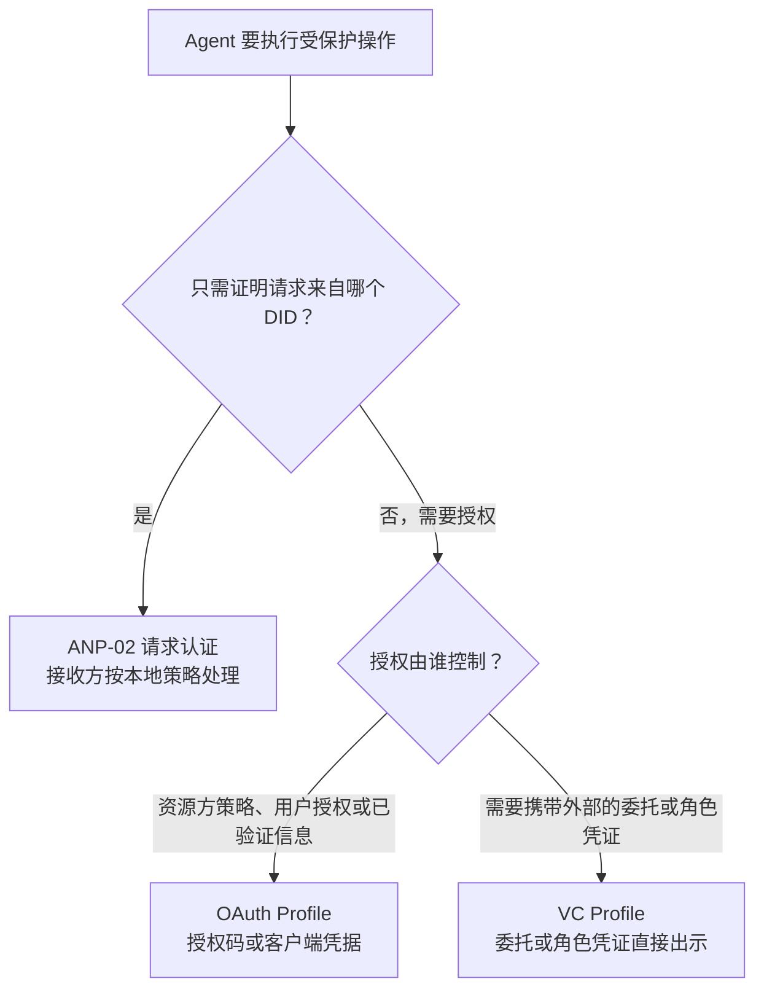
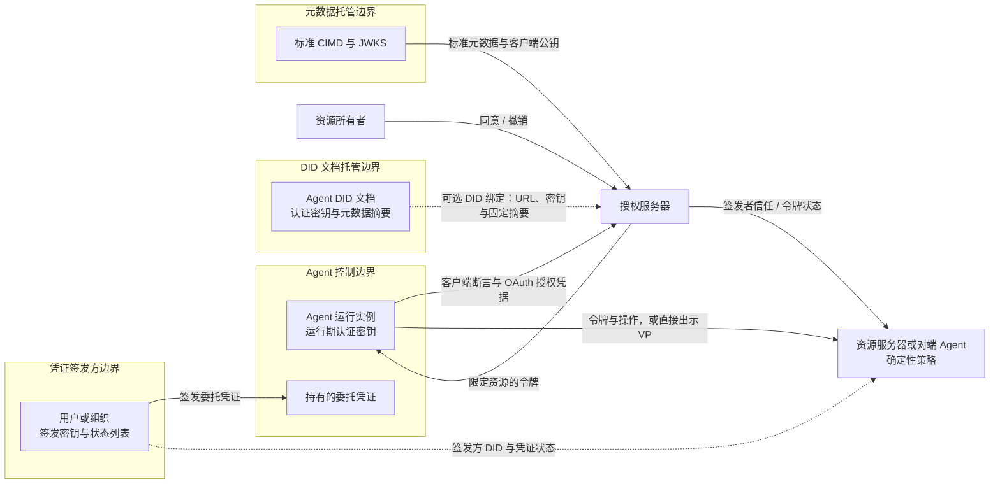
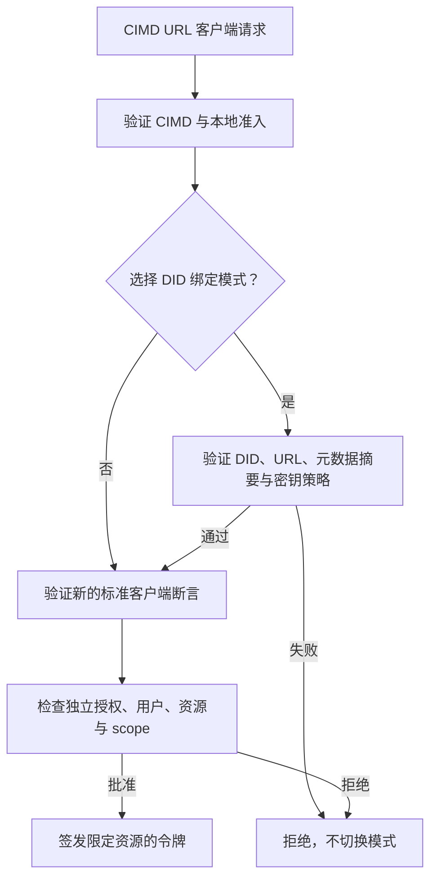
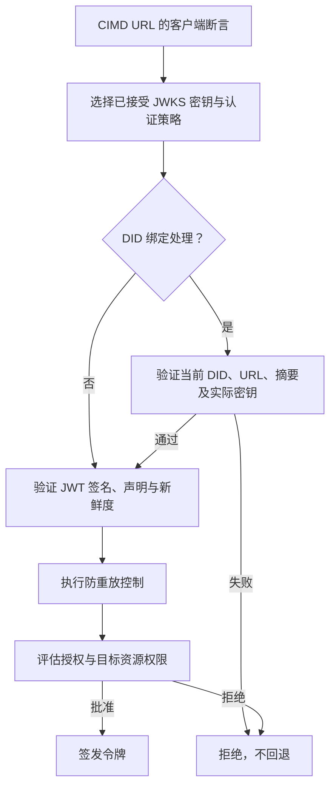
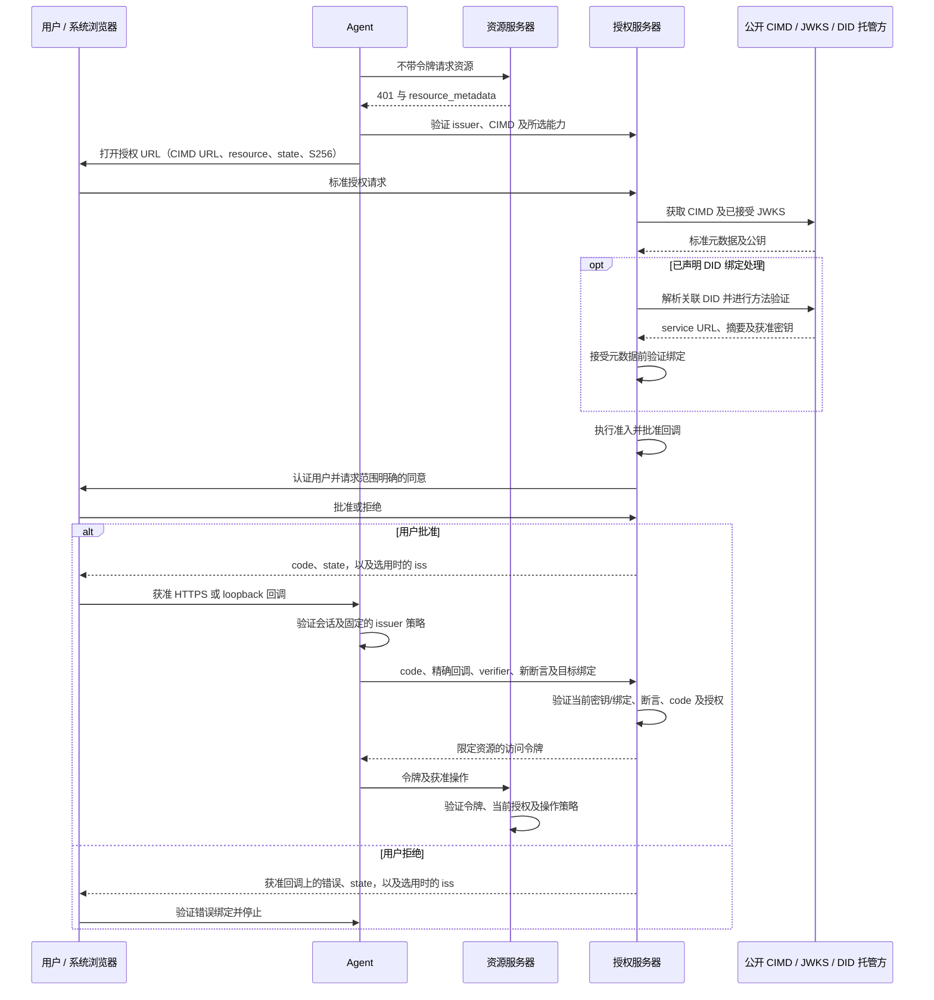
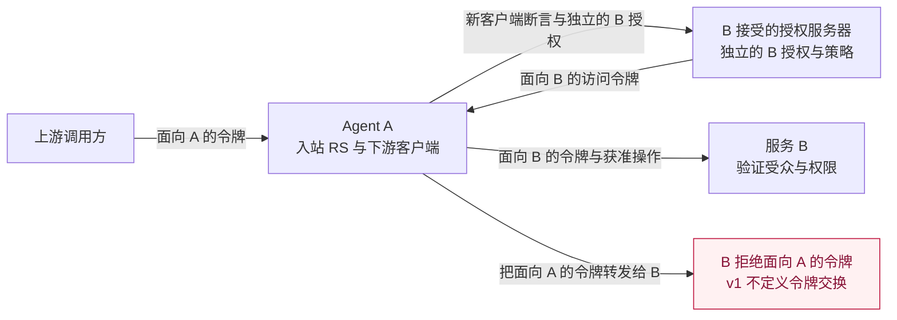
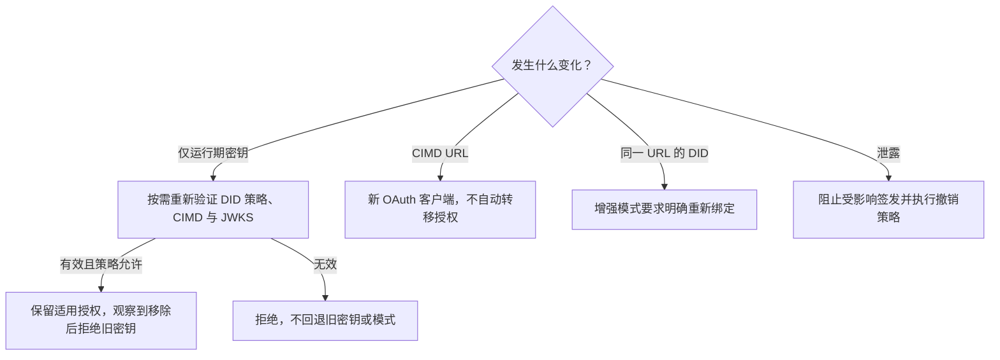

# ANP 基于 DID 的授权协议

- 文档编号：ANP-05
- 状态：草案 / 未发布
- 版本：0.7
- 规范集：ANP vNext；不属于 ANP 1.2 发布范围
- 草案 Profile 标识：OAuth Profile `anp.authorization.oauth2.cimd.v1-draft1`；VC Profile `anp.authorization.vc.v1-draft2`
- 语言：中文
- 英文镜像：[ANP DID-Based Authorization Protocol](../05-anp-did-authorization-protocol-specification.md)

<a id="scope"></a>
## 1. 范围、授权问题与路线图

ANP-05 定义基于 DID 的智能体授权方向，由两种互补机制组成：**OAuth Profile**，由资源方信任的授权服务器签发访问令牌；**VC Profile**，由拥有授权依据的用户或组织签发 W3C 可验证凭证（Verifiable Credential，VC），Agent 持有并出示。DID 在 ANP 层标识主体。OAuth 路径中，普通 AS 使用 URL 客户端标识及其自身的资源所有者身份；只有明确验证 DID 绑定后，该 AS 才能确认关联的 DID。VC 路径用 DID 标识签发方及被授权 Agent。**第一版（v1）是 DID–OAuth 客户端身份与基础委托访问 Profile，加上直接出示的单级 VC 委托凭证与组织角色凭证，不是完整的智能体委托体系。** 当前文档是其尚未发布的 v0.7 草案。本文的“v1”指首个版本的能力范围，不代表 v1 已发布，也不代表路线图中的后续能力已经实现。

在 OAuth Profile 中，Agent 将自己的 DID 与标准 OAuth 客户端标识元数据文档（Client ID Metadata Document，CIMD）的 HTTPS URL 关联，并用已发布的认证密钥证明该 URL 客户端身份；资源所有者批准权限，授权服务器（AS）签发受限令牌，资源服务器（RS）执行访问控制。这条路径不要求 VC、VP、OIDC 登录桥接或区块链。在 VC Profile 中，有权主体向 Agent 签发凭证，Agent 通过与持有者绑定的可验证出示（Verifiable Presentation，VP）向验证方出示；验证方独立验证签发方、持有者、凭证状态、权限、约束与本地信任策略，然后执行或拒绝请求的操作。

OAuth Profile 的基线为 **OAuth 2.0 与已发布扩展**，包括 RFC 6749、RFC 9700，并明确固定使用 CIMD draft-02 定义 URL 客户端标识及元数据发现。CIMD 是仍在制定中的依赖，不是已发布 RFC。OAuth 2.1 draft-16 与 JWT 客户端认证更新 draft-11 只作为资料性设计参考，不是已发布 RFC 依赖。VC Profile 的规范性基线为 W3C VC 数据模型 2.0、VC Data Integrity 1.0 及其 EdDSA 密码套件、Bitstring Status List 1.0。大写 MUST（必须）、MUST NOT（不得）、SHOULD（应当）、SHOULD NOT（不应）、MAY（可以）使用 BCP 14 定义。下文的收紧规则是本 Profile 的要求，不是对所引用规范的修改。

**ANP-05 v1 定义两条相互独立的授权路径：基于 DID 客户端身份的 OAuth 资源访问授权，以及基于持有者绑定 VC 的可携带委托与组织角色凭证出示。v1 不定义 VC/VP 到 OAuth Access Token 的转换。本版本不定义独立的资质或属性凭证 Profile。**

文档结构：第 1 节说明要解决的授权问题与路线图；第 2 节说明与 ANP-02 的关系，以及何时使用 OAuth、何时使用 VC；第 3–10 节定义 OAuth Profile；第 11 节定义 VC Profile；第 12–14 节是两者共同的错误处理、安全与一致性要求。

<a id="authorization-problem"></a>
### 1.1 智能体授权真正要解决的问题（资料性）

核心不只是“哪个 Agent 持有这把密钥”，而是**“谁把什么资源上的哪些操作授权给了哪个 Agent，受到哪些限制，以及如何终止授权”**。本方向围绕五项需求展开：

| 需求 | 必须解决的问题 | v1 边界 |
| --- | --- | --- |
| 人把权限委托给智能体 | 记录授权人、被委托 Agent、资源、操作、期限与撤回；自然语言任务本身不是资源授权。 | OAuth：授权码流程取得用户同意或使用已有有效授权；区分用户与客户端主体，执行 scope、期限和撤销。VC：用户或组织签发单级委托凭证（第 11 节），作为可携带的委托书：签名可由任何验证方独立检查，但接受授权仍要求实时的状态检查；验证方仍独立决定权限。 |
| 组织授权智能体代表组织行事 | 公司把某个 Agent 任命为 HR Agent 或采购 Agent，由它代表公司对接事先未知的招聘平台、供应商或对端 Agent；对方需要确认这个 Agent 确实代表该公司、能做哪些事、上限是多少。 | VC：组织签发角色凭证（第 11.2 节），按业务动作而不是按资源地址列出职能与约束；对方确认签发方就是该组织，并把动作对应到自己的操作后决定是否接受。不定义跨对方的累计预算，也不自动授权访问第三方的个人数据。 |
| 同一智能体代表用户访问多个服务 | 各服务独立管理资源、账户身份与策略，某处的权限和同意不能通用于其他服务。 | OAuth：同一 Agent DID 分别对各资源及其认可的 AS 执行授权流程，保存独立授权和目标受限令牌。VC：一份委托凭证可以列出多个服务的资源，每个验证方只采用与自己相关的条目，并独立确认签发方对该资源有权。不定义一次全网同意或跨 AS 账户等价。 |
| 多级转委托 | A 委托 B、B 委托 C 时不得扩权，必须保留用户/执行者归因，并处理撤销传播与共享限制。 | 不定义该流程。VC Profile 只接受由验证方独立认可的授权主体直接签发给 Agent 的凭证；签发资格不能从签发方自己持有的委托凭证、角色凭证或访问令牌推导，因此持有他人委托的 Agent 再签发的凭证会被拒绝。不得把转发令牌、凭证或私钥当作隐式转委托。 |
| 高风险操作逐笔批准 | 把人的批准绑定到确定的收款方、金额/币种、披露或删除对象、有效期及唯一操作标识。 | 不定义通用逐笔批准凭据。委托凭证表达的是事先划定的授权范围，也不是逐笔批准。服务要求独立批准时，必须验证自身明确的操作批准机制，否则阻止操作。登录、宽泛 scope、DID 签名或 DPoP 本身不是该批准。 |

基础同意记录和 VC 委托凭证都已把受限访问权限委托给 Agent，因此不能说 v1 完全没有“人→Agent”授权。VC 委托凭证提供了可移植的委托书，但只覆盖单级委托；v1 尚未定义的是**委托链和标准化逐笔批准**。用户指令可以指导执行，但不能创造用户或 Agent 原本没有的资源权限。

<a id="technical-choices"></a>
### 1.2 技术选择与实现代价（资料性）

**复用 OAuth 管理授权生命周期。** RFC 6749 已区分资源所有者、客户端、AS、RS，并提供同意/授权、访问令牌及刷新流程；RFC 7523 第 2.2 节提供客户端断言传输；RFC 7636、RFC 8707、RFC 7009、RFC 7662 分别提供授权码保护、目标资源限制、撤销及状态检查。ANP 因而可集中定义可复用的 Agent 身份与缺少的智能体委托语义，不必重新建立另一套授权/令牌生态。OAuth 不是全部答案：任务总预算、权限衰减及用户对具体业务动作的批准，并不会因采用 OAuth 自动获得。

**DID 标识主体，不授予权限。** 同一经过方法验证的 DID 及选定的认证密钥关系可以用于普通 ANP 认证、通信和 OAuth 客户端公钥发布。标准 CIMD 模式下，AS 认证的是 URL 客户端；只有执行额外 DID 绑定检查的验证方，才能声称已认证所关联的 DID。原生 did:web 仍以 DNS/HTTPS/托管为信任基础，不会因为采用本 Profile 就获得指纹绑定身份或抵抗自身 DID 文档托管方的保证。路径型 did:wba e1_ 增加绑定密钥指纹与可验证文档证明。这些性质均以正确的方法验证和密钥保管为前提；两种方法都不证明软件完整性或用户同意。这里的价值是共同的身份/生命周期模型，不是宣称只有 DID 才能提供可移植标识。

**复用 CIMD 接入现有 OAuth 生态。** 主要优势是：已经支持 CIMD 及所选标准 OAuth 能力的授权服务器，可以在不对客户端标识、元数据发现、授权或令牌流程进行 ANP 专用改造的情况下处理该客户端。OAuth `client_id` 仍为 CIMD HTTPS URL；DID 文档提供 ANP 身份关联，发布方把选定认证密钥导出为标准 JWKS。DID 适配因而位于 Agent SDK 或元数据发布器，不必要求每个 AS 部署 DID 解析器。兼容性取决于 AS 的准入策略、支持的认证算法和所选流程；这不代表每个 OAuth 服务器都支持 CIMD，也不代表标准 CIMD 服务器已经验证 DID。第 4 节区分普通 CIMD 处理与可选、明确协商的 DID 绑定验证。未来扩展可以探索 DID 本身作为 `client_id`（第 16 节），届时需明确 AS 支持及迁移规则。私钥留在 Agent 或它明确批准的签署方。

**用 VC 承载来自资源方之外的授权依据。** 许多智能体授权的依据并不在资源方手里：公司任命某个 Agent 为采购代表，用户给 Agent 一份可以交给多个商家的委托书，或者某机构证明 Agent 属于哪个组织、具备什么资质。OAuth 的同意记录保存在各 AS 内部，无法带到另一个服务，也无法由没有 AS 的对端验证。W3C VC 2.0 让授权方用自己的 DID 签署声明，由 Agent 持有，并出示给任何信任该签发方的验证方；验证只需解析签发方与持有者的 DID 并查询状态列表，验证方不必与签发方预先对接。ANP 已在 did:wba 文档证明和消息绑定中使用 Data Integrity 的 eddsa-jcs-2022，VC Profile 复用同一证明机制，不另外引入签名栈。VC 也有代价：撤销依赖状态列表，存在缓存延迟；验证方必须自己维护“信任哪些签发方做哪类声明”的策略；凭证一旦出示，其内容就被验证方看到。

**VC 与 OAuth 分工，不互相替代。** v1 中二者是独立的授权路径。OAuth 用于资源方通过 OAuth 授权记录与访问令牌管理的授权；本版 VC Profile 用于携带来自资源方之外的委托或组织角色凭证，并由其他方独立验证；资质或属性凭证只能按另行约定的规则作为验证方明确要求的附加证明。OAuth 的授权决定也可以依据角色、资质、组织身份或其他已验证信息。后续扩展可以定义外部凭证如何成为 OAuth 授权决定的输入；v1 不定义 VC 到访问令牌的换发。何时选择哪一种，见第 2.2 节。后续阶段提及的标准是评估方向，不是本版一致性要求。

<a id="v1-scope"></a>
### 1.3 v1 交付什么

v1 的交付目标是**与 DID 关联的 OAuth 客户端身份，加上可使用、可审计的基础用户委托**：标准 CIMD URL 客户端标识、DID 到 CIMD 的发现及公钥发布、可选的完整性校验 DID 绑定、启用时无需逐 AS 预注册且受策略控制的首次准入、RFC 7523 客户端认证、适用于合格机密部署的客户端凭据、面向托管 HTTPS 与本机 loopback 客户端的 S256 PKCE 授权码、目标限定令牌、可选刷新与生命周期执行。在 OAuth Profile 中声明支持用户委托的部署必须（MUST）实现授权码路径；只实现客户端凭据的部署不得（MUST NOT）宣称具备 OAuth 用户委托能力。只通过 VC Profile 接受委托的验证方不受此项约束。

用户委托授权中，AS 必须（MUST）记录其 issuer/租户上下文内已认证的资源所有者标识、URL 客户端标识、仅在验证通过时记录的关联 Agent DID、目标资源、获准 scope、批准来源及时间、适用期限/撤销策略，以及稳定的内部授权记录标识。只有在文档化策略认可时，已有同意或管理员授权才可作为批准来源。这是 OAuth 授权记录要求；可跨系统携带的委托书由 VC Profile 定义。新增权限需要新的批准决定；用户凭据与 Agent 认证密钥保持分离。

VC Profile 是可选能力，交付：ANP 委托凭证与组织角色凭证两种类型、持有者绑定的出示、签发方与持有者验证、凭证状态检查、权限与约束求值，以及向资源服务器或对端 Agent 直接出示。声明支持 VC Profile 的实现必须（MUST）满足第 11 节中适用于其角色的要求；不支持 VC 的实现仍可完整符合 OAuth Profile。有效的委托凭证不替代验证方的授权决定。

**安全基线：**本 Profile 不得（MUST NOT）使用隐式授权、资源所有者密码凭据授权、URI 查询中的访问令牌或 PKCE plain。授权码必须采用 S256 PKCE、获准回调匹配（仅有下文明确限定的 loopback 端口例外），以及 issuer/会话验证。不得（MUST NOT）把路线图中的后续能力宣告为 v1 已支持能力。

<a id="roadmap"></a>
### 1.4 分阶段方案与验收路线（资料性）

以下是有先后依赖的能力阶段，不是交付日期承诺。后续阶段可以独立扩展发布，不改变 v1 的身份/授权分工。

| 阶段 | 方案方向 | 宣称能力前的验证证据 |
| --- | --- | --- |
| v1：身份与基础委托 | 实现第 1.3 节范围。同一 DID 分别向多个服务取得独立授权，保留用户/Agent 归因和明确撤销机制；授权依据来自资源方之外时，通过直接出示使用单级 VC 委托凭证或角色凭证。 | CIMD 首次接触及可选 DID 绑定验证；已声明的托管与 loopback 用户流程；两资源隔离；元数据篡改；密钥轮换；撤销；VC 直接出示的正反例；第 14 节客户端/AS 互操作证据。 |
| 下一阶段：精细权限与高风险批准 | 评估 RFC 9396 RAR 表达结构化资源/动作/限制；另行定义单次批准，可以是专用 VC 类型或其他凭据，绑定 Agent、资源、规范化后的精确动作摘要、关键参数、期限和唯一标识，由执行端原子检查并消费。 | 参数替换、重放、重复执行、过期与撤回均安全失败；重新登录、传输请求签名或宽泛的委托凭证不能代替逐笔批准。 |
| 再下一阶段：受控转委托 | 评估 VC 委托链（子凭证引用父凭证并收窄权限）以及 RFC 8693 Token Exchange 的执行者归因；定义允许的委托深度、子授权不超出父授权有效权限、受众/期限收窄、授权族撤销与审计。跨 AS 交换须明确建立信任及账户/权限对应。v1 不定义 VC 到 OAuth 令牌的换发或多级转委托。 | A→B→C 委托；扩权或执行者不符时拒绝；根授权撤回后阻止新子授权；记录已签令牌的失效延迟。不能只凭执行者历史声明授权。 |
| 配套演进：长期与无交互执行、隐私 | 评估 RFC 8628 支持远端/无界面授权，研究其他后端授权流程、经验证的 DID 迁移和共享预算/计数执行。评估 VC 选择性披露密码套件，以及面向人类钱包的 OpenID4VP/OpenID4VCI 绑定。为采购、HR 等常见业务职能评估可互操作的动作词表，由相应领域协议定义并治理。v1 loopback 覆盖浏览器位于 Agent 同一设备的情况，不覆盖全部无界面环境。 | 用户与设备/事务绑定、防钓鱼与轮询控制；用户授权过期不能改走客户端自身权限；多个子任务并发时仍正确执行共享限额；选择性披露不泄露未出示的权限条目。 |

计划统一描述授权人、目标 Agent、资源/动作、限制、适用的父授权、批准证据与撤销状态；具体线协议 Schema 和执行规则在后续扩展中制定。签名声明预算不等于实现全局计数器；令牌交换本身不等于已经实现撤销传播或权限衰减。

本草案发布不代表 SDK、AS 或产品已支持。0.7 修订用实验性 `anp.authorization.oauth2.cimd.v1-draft1` 替换此前 DID 作为 client_id 的 OAuth 设计；独立的 VC Profile 保持为 `anp.authorization.vc.v1-draft2`。原 `anp.authorization.oauth2.did.v1-draft4` 标识不是本修订的别名。0.6 修订移除了 VC 到 OAuth 令牌的换发；0.5 修订新增 VC Profile。实现必须（MUST）精确匹配修订，并在迁移前重新验证受影响元数据和未完成事务。客户端标识变化意味着新的 OAuth 客户端，不能通过更新 Profile 字符串来重新解释现有授权或 code。

<a id="anp-boundary"></a>
## 2. 与 ANP 的关系及机制选择

使用当前 [ANP-02 身份材料规则](02-ANP-基于DID的身份认证协议.md#identity-input)、[ANP-03 WBA 绑定](03-did-wba方法规范.md#wba-auth-binding)和 [ANP-02 原生 Web 绑定](02-ANP-基于DID的身份认证协议.md#web-binding)。Git 历史中的发布前快照不是本草案的规范性基线。

ANP-02 定义 HTTP/JSON 请求认证。ANP-05 复用其 DID 验证与认证密钥授权模型，**不复用**其 HTTP 签名序列化、挑战或可选的令牌响应头。OAuth 令牌端点使用 `client_assertion` 和标准 OAuth JSON 令牌响应，不得（MUST NOT）要求再附加一份 ANP-02 HTTP 签名才能满足本 Profile。需要将 HTTP Message Signatures 作为另一种 OAuth 认证方式的部署，应另行定义明确的绑定。

ANP-02 的认证缓存令牌不会自动成为 ANP-05 的 OAuth 授权令牌，实现必须（MUST）分离二者的接受规则。本 Profile 不依赖消息、WNS、Device Manifest、E2EE 或人类在场确认界面；VC 直接出示可以由 ANP-02 认证的 HTTP 接口或已认证的消息会话承载，但不改变这些协议的规则。DID 的 `authentication` 关系允许某密钥进行身份认证，并不授予应用资源的访问权限。

### 2.1 如何选择 ANP-02、OAuth 或 VC（资料性）

| 需求 | 选择 | 凭据含义 |
| --- | --- | --- |
| 认证直接 API 请求或通信对端，由接收方执行已有本地策略 | ANP-02 | 可选令牌在该 API 策略下复用已认证上下文，不建立标准化用户委托授权。 |
| 代表用户取得受限权限，或使用 AS 管理的客户端授权、资源受众、同意、期限与撤销 | ANP-05 OAuth Profile | AS 为特定授权及资源签发 OAuth 访问令牌。 |
| 出示来自资源方之外的委托或组织任命，可按验证方要求附加另行约定的资质证明，由验证方直接验证和决定是否采纳 | ANP-05 VC Profile | 签发方签署的声明；验证方按自身策略决定是否采纳，凭证本身不是访问令牌。 |

服务可以在明确分离的路由或声明的策略下同时提供多种机制。使用 JWT、签名 JSON 或把对象称作“令牌”，不会使它们可互换。ANP-05 不要求先取得 ANP-02 令牌；普通认证消息也不强制采用 AS。RS 不得（MUST NOT）把原始 VC 或 VP 当作 Bearer 访问凭据接受。

<a id="mechanism-selection"></a>
### 2.2 OAuth 与 VC 的分工（资料性）

两者回答的是不同问题。**OAuth 回答“资源方现在是否允许这个客户端对这个资源执行这个操作？”**：资源方信任的 AS 根据本地策略、用户授权、角色、资质、组织身份或其他已验证信息作出决定，再签发目标受限的访问令牌。**VC 回答“哪个签发方对这个 Agent 作出了什么可验证声明？”**：Agent 可以携带来自外部签发方的声明交给不同第三方，各验证方自行决定是否信任签发方及是否允许该操作。资质与角色也可成为 OAuth 决策输入；是否需要可携带、可独立验证的外部声明，是使用 VC 的关键。

| 维度 | OAuth 访问令牌 | VC 委托凭证或组织角色凭证 |
| --- | --- | --- |
| 签发方 | 资源方信任的 AS | 授权依据的来源：用户、组织或资质机构 |
| 授权决定 | AS 在签发令牌前做出，RS 执行 | 每个验证方在凭证直接出示时做出 |
| 适用范围 | 单一资源；本 Profile 每个令牌只绑定一个 `resource` | 凭证列出的范围，可以跨多个服务；各验证方只采用与自己相关的条目 |
| 验证依赖 | 可信 AS 的签名密钥或 introspection | 签发方 DID、持有者 DID 与状态列表；验证方不必与签发方预先对接 |
| 有效期与撤销 | 短期令牌；AS 可以集中停止签发和刷新，但已签发的令牌在过期或 RS 得知撤销之前仍可能被使用 | 有效期通常更长；通过状态列表撤销，延迟取决于状态列表的发布与缓存 |
| 需要的交互 | 用户委托时在 AS 登录并同意；客户端与 AS 往返 | 签发时由授权方确认一次；出示时 Agent 与验证方交换 challenge 和持有者绑定 VP，并检查 DID、状态与本地策略 |
| 隐私 | 令牌内容对客户端通常不透明；AS 掌握每次授权 | 出示的凭证内容对验证方可见；签发方不参与出示，但状态列表查询会向其托管方暴露验证方的网络地址 |

**适合使用 OAuth 的情况：**

- 资源由某个服务托管，并且该服务有自己的用户账户体系。例如 Agent 读取用户在文档服务里的文件、写入用户日历：用户在该服务登录并同意，服务掌握完整的授权记录。
- Agent 以自身名义调用服务（机器对机器），权限由服务方配置，使用客户端凭据。
- 资源方需要集中管理撤销、短期令牌、按资源隔离或增量授权。
- 资源方已有 OAuth 基础设施，希望 RS 只验证令牌、不改动。

**适合使用 VC 的情况：**

- 授权依据来自资源方之外。例如企业授权采购 Agent 以公司名义向供应商下单，额度与期限由企业决定；供应商需要确认的是“这家企业确实授权了这个 Agent”，而不是企业员工在供应商系统里登录同意。
- 组织任命 Agent 担任某个职能角色。例如公司的 HR Agent 代表公司在招聘平台发布职位、与候选人的 Agent 约面试，采购 Agent 代表公司向新供应商询价下单。对方往往事先不认识这个 Agent，公司也无法预先列出所有对方的地址；角色凭证按业务动作说明“这个 Agent 代表本公司做什么、上限多少”，见第 11.9 节。
- 同一份授权要交给多个互不对接的服务。例如用户签发一份委托凭证，允许 Agent 在几家酒店比价预订，每家酒店各自验证，用户不必逐一登录同意。
- 对方提供支持 VC 的接口，包括 Agent 间点对点协作；是否存在 OAuth AS 不改变该出示流程。此时，对端需要确认“这个 Agent 代表哪个用户或组织、被允许做什么”。
- 验证方明确要求在授权凭证之外附加组织成员身份、行业资质、实名核验结果或 Agent 运营方等属性证明。本版只定义委托凭证与组织角色凭证两种授权类型；附加属性凭证的类型、主体绑定、签发方信任与采纳规则须另行约定，并按第 11.3 节随授权凭证出示。本版不定义资质或属性凭证独立出示的完整绑定，属性凭证本身不授予访问权限。

**首版边界。** OAuth 与 VC 是独立的授权入口。提供 VC 接口的验证方直接检查出示与请求的操作；只接受 OAuth 的接口仍要求通过其支持的 OAuth 流程取得授权，不能用 VC 直接出示绕过。VC 与 OAuth 的组合仅作为第 16 节的后续扩展方向。



### 2.3 信任边界（资料性）



架构及 OAuth/VC 分工保持不变。实线元数据路径适用于普通 CIMD AS；虚线 DID 路径只在验证 DID 绑定时启用。图中把 DID 文档托管单列为一个边界。对 did:wba e1_，文档完整性来自 Agent 控制的绑定密钥证明，托管方只能拒绝服务或重放旧文档；对原生 did:web，托管方被攻破就能替换密钥与摘要（见第 4.2 节）。签发方与资源所有者可以是同一个人，但签发密钥始终由签发方控制，不交给 Agent。

<a id="roles"></a>
## 3. 角色与标识

第 3–10 节定义 OAuth Profile。第 11 节的 VC Profile 定义独立的直接出示流程，其持有者与验证方不因采用 VC 而承担 OAuth 客户端或 AS 的职责。AS 可以作为普通业务组件实现 VC 验证方，但本版不赋予它 VC 换令牌的特殊角色。

| 术语 | 含义 |
| --- | --- |
| 客户端 / Agent 运行实例 | 申请并使用访问令牌的软件部署，其身份与资源所有者区分。 |
| Agent DID | 通过 DID 文档与 OAuth 客户端关联的 ANP 身份；不是 OAuth 线协议标识，也不一定是人类用户的 DID。 |
| `client_id` | 作为 OAuth 客户端标识的精确 HTTPS CIMD URL。 |
| 资源所有者 | 有权授予资源访问权限的用户或组织。 |
| 授权服务器（AS） | 认证 URL 客户端、验证授权凭据与策略并签发令牌；只有启用 DID 绑定处理时才验证 Agent DID。 |
| 资源服务器（RS） | 执行资源访问控制的目标 Agent、API 或网关。 |

请求 `client_id`、CIMD `client_id` 和客户端断言 `iss`、`sub` 必须（MUST）是完全相同的 CIMD URL。客户端断言的 `sub` 标识客户端。访问令牌的 `sub` 标识授权所针对的主体：在用户委托访问时通常是资源所有者；在客户端自身访问时由 AS 确定。不得（MUST NOT）仅因认证成功，就把客户端断言的 `sub` 直接复制到用户委托令牌中。

客户端断言的 `aud` 按固定的认证策略标识被接受的 AS；访问令牌的 audience 标识目标 RS。同一 Agent DID 与 CIMD URL 可以在多个 AS 使用，但准入、授权、用户账户和令牌仍分别受各 AS 管理。令牌不会因为客户端拥有 DID 就自动通用于所有服务。

客户端记录、授权及令牌缓存必须（MUST）按 (issuer, tenant-or-trust-domain, client_id) 隔离，并分别保留资源所有者、授权、目标资源与处理模式。RFC 9068 JWT 访问令牌必选的 `client_id` 声明承载 URL，不得填入所关联的 DID。RFC 7662 introspection 保持标准语义：返回 `client_id` 时，其值为 URL。策略依赖客户端身份的 RS 必须（MUST）从可信令牌/introspection 上下文或等价可信状态取得该身份；所需身份不可用时，必须（MUST）拒绝该决策，不能相信调用方提供的字段。本 Profile 不要求普通 CIMD AS 在令牌中增加 DID 声明。

支持 ANP 的 AS 单独记录成功验证的 DID 绑定、Profile 修订与验证状态。向 RS 传递结果需要明确可信的通道或双方约定的令牌扩展；本版不强制新增令牌声明。RS 不得（MUST NOT）从未经验证的 `anp_did`、`kid` 标签或某 URL 当前的内容推断 DID 已经验证。若 AS 未验证绑定，而资源要求 DID 认证，则需要按另行约定的绑定提供与实际请求/令牌关联的独立证明，否则必须（MUST）拒绝该操作。本修订不定义这种证明交换。

多个 Agent 实例共用 CIMD URL 时，该 URL 仍表示一个 OAuth 客户端。需要逐 Agent 独立客户端身份的部署应当（SHOULD）发布不同的稳定 URL 及认证密钥。多个用户共用 URL，不会替代各 issuer 范围内的资源所有者身份。这是身份关联，不是自动合并账户、软件证明或权限授予。

<a id="enrollment"></a>
## 4. 客户端登记与绑定

### 4.1 CIMD URL 作为客户端标识

本修订使用 CIMD draft-02 定义的 HTTPS 客户端标识 URL。该 URL 必须（MUST）含路径，不得（MUST NOT）含 userinfo、片段或单点/双点路径分量。本 Profile 的发布方必须（MUST）省略查询部分。一次正常表单/JSON 解码后按字符串精确比较，不得通过端口、大小写、路径或别名规范化将不同标识视为等价。OAuth `client_id` 字段中不得（MUST NOT）用 DID 或 DID URL 替代 CIMD URL。

在事务开始前选择以下两种处理模式之一：

| 模式 | 验证职责 |
| --- | --- |
| `cimd` | 标准 CIMD 元数据发现、URL 客户端认证及 OAuth 授权。AS 无需解析 DID、理解 ANP 扩展或检查 DID 内固定的摘要。 |
| `did_bound` | 使用相同的标准 URL 客户端与 OAuth 消息，额外执行第 4.2 节和第 6.2 节的 DID/URL/元数据/实际认证密钥检查。AS 按第 5 节明确声明该增强能力。 |

明确归属于 `did_bound` 的要求，只在实现并启用该增强能力时适用，不得（MUST NOT）将其作为普通 CIMD AS 处理标准流程的前提。下文共同的 OAuth 安全要求约束参与实现及能力选择；支持 CIMD 本身不等于声明支持本文涉及的全部可选 OAuth 扩展。连接要求某项尚不支持的能力时，应在授权前失败，而不是要求采用 ANP 专用替代协议。

客户端必须（MUST）在授权前固定被接受的 issuer、URL `client_id`、所选模式及认证策略。要求 DID 绑定身份时，缺少精确匹配的增强能力或其检查失败，必须（MUST）终止操作，不得（MUST NOT）自动切换为 `cimd` 模式重试。明确配置的 `cimd` 连接有效，但不得（MUST NOT）宣称 AS 已完成 DID 认证。未来 DID 作为 client_id 的研究属于另行协商的扩展（第 16 节）。

<a id="anpcimd"></a>
<a id="anp-oauth-keys"></a>
<a id="anp-metadata-sha256"></a>
### 4.2 自发布 OAuth 客户端元数据

ANP 发布方通过本 Profile 中唯一的 `ANPCIMD` 类型 service，将 Agent DID 与 CIMD 关联。其 `id` 必须（MUST）是该 DID 加非空片段，`serviceEndpoint` 必须（MUST）精确等于 CIMD HTTPS URL。ANP 发现过程拒绝重复 service ID 或多个匹配 service。`ANPCIMD` 是 ANP 定义的实验性 DID service 类型，不是 W3C 定义的类型。JSON-LD 部署需要明确、固定的扩展 context；DID Core context 不定义这些扩展词项。旧 `ANPOAuthClientMetadata` service 不用于选择本新 Profile。

发布方必须（MUST）将经过方法验证的 DID 材料与明确的 OAuth 应用配置结合。下列映射是发布过程的规范性要求，不要求标准 AS 进行 DID 解析：

| 输出 | 来源与规则 |
| --- | --- |
| `client_id` | 与 DID 关联的精确 CIMD URL。 |
| `jwks` 或 `jwks_uri` | 从 DID 获准的 `authentication` 方法中选出的公开签名密钥，不得导出私钥材料。`jwks_uri` 必须（MUST）提供标准 JWK Set，不能直接返回未转换的 DID 文档。这两个元数据字段必须且只能使用一个。 |
| `client_name`、`client_uri`、`logo_uri` | 明确的应用显示配置；客户端自述名称不是已验证组织身份。 |
| `redirect_uris` | 应用实际回调配置；不能只根据 DID 域名推导回调。 |
| `grant_types`、`response_types`、`scope` | 已实现/请求的 OAuth 能力及应用配置；这些值不授予权限。 |
| `token_endpoint_auth_method` | 本 Profile 的客户端认证路径使用 `private_key_jwt`。采用 `none` 的公共客户端连接不属于其基于 DID 的客户端认证能力。 |
| `token_endpoint_auth_signing_alg` | 提供时须为受支持且与选定密钥兼容的非对称算法；实际使用仍要求 AS 支持。 |

CIMD 文档必须（MUST）遵循 CIMD draft-02 及适用的 RFC 7591 元数据语义。它必须（MUST）将自身精确 URL 作为 `client_id`，并包含非空 `client_name`。授权码发布包含 `response_types=["code"]` 和已配置的 `redirect_uris`。文档必须（MUST）可通过无需认证的 HTTPS GET 获取，返回 HTTP 200 与 JSON；发布方应当（SHOULD）使用 `application/json`。获取方不得（MUST NOT）自动跟随重定向，或将错误响应接受为元数据。不得发布共享 secret、私钥或 bearer 凭据。每次获取均受第 13 节约束，包括外部 JWKS 获取。

`anp_profile` 和 `anp_application_type` 不是必选 CIMD 成员。仅含标准字段的 CIMD 文档已足以用于 `cimd` 模式。可选的实验性 `anp_did` 成员标识用于反向发现的候选裸 Agent DID；在 DID 绑定检查通过前不具备可信效力。无需反向发现，或可信带外绑定已提供 DID 时，发布方可以（MAY）省略该字段。普通 AS 无需理解它；必须验证与 AS 所接受元数据的兼容性，不能静默更换事务的客户端身份或安全模式。

在 `did_bound` 发布与验证中，`ANPCIMD` service 还必须（MUST）包含：

- `anp_oauth_keys`：来自该 DID `authentication` 关系的、互不重复的验证方法 ID 非空数组，明确授权这些密钥用于所关联的 URL 客户端。每个引用经 DID Core 相对引用处理后，必须解析为该 DID 加非空片段。该字段不授权 `keyAgreement` 密钥，也不授权仅列于 `verificationMethod` 中的任意密钥。
- `anp_metadata_sha256`：覆盖完整 CIMD 表示的 64 位小写十六进制 SHA-256 摘要。对 HTTP 传输/内容解码后的 UTF-8 响应字节计算摘要，包括空白及末尾换行；不重新序列化 JSON，不包含 HTTP 头。拒绝 BOM、无效 UTF-8 及重复 JSON 成员。完成序列化后计算摘要，再通过 DID 方法认证的文档更新流程发布。

增强 AS 在将元数据用于回调或授权决定前，必须（MUST）从可信配置或可选 `anp_did` 发现提示取得候选 DID，验证 DID 及 service，精确检查 URL 和适用的反向 DID 一致性，并验证固定摘要。必选绑定缺失、格式错误或不匹配均拒绝。调用方提供的覆盖值，或仅由元数据托管方提供的摘要，不能替代该验证。冲突的反向 DID 不得（MUST NOT）覆盖已有的已接受绑定。这些检查完成前，获取的候选名称或回调不可信。增强获取方必须（MUST）支持至多 5 KiB 的文档，并设置有限的大小、超时及并发上限。

摘要覆盖内嵌的 `jwks` 值，但对 `jwks_uri` 只覆盖 URL 字符串，不保护独立获取的 JWKS 字节。两种形式下，**实际用于该客户端认证的密钥**都必须（MUST）属于 service 的 `anp_oauth_keys`，且当前仍受已验证 DID 的 `authentication` 关系授权。比较经验证的真实公钥材料或 RFC 7638 JWK 指纹，不能只比较 `kid`，并拒绝有歧义的密钥选择。仅在 JWKS 的其他位置找到一把匹配密钥不够。本修订保护 CIMD 字节与实际获准的认证密钥，不定义整个外部 JWKS 文档的摘要。

普通 CIMD AS 信任其接受的 HTTPS 元数据和客户端认证策略；发布方本地完成 DID 检查，不证明 AS 获取了同一状态或已经验证 DID。增强模式下，DID 授权的摘要将元数据托管方限制为交付方，不能独立修改内容。对 did:wba e1_，绑定由方法有效的文档证明覆盖；对 did:web，控制 DID 文档托管方仍可替换密钥与摘要。两种模式都不会获得超出所选 DID 方法与新鲜度策略的抗回滚能力。在使用摘要固定保护时，后续元数据更新即使仅涉及显示内容，也必须重新计算固定摘要。

### 4.3 无需逐 AS 预注册的首次接触准入

CIMD AS 可以（MAY）接纳此前未知的客户端标识 URL，也可以将准入限制为已批准/预注册客户端。CIMD 不强制开放准入。对已启用 CIMD 首次接触的 AS，ANP 不增加强制人工登记或注册接口调用。准入不授予资源访问权限。

首次接触流程如下：

1. 在获准联网前，检查 URL 语法、所选流程、接受的 issuer 及本地停用/准入策略。缓存未命中不得（MUST NOT）抹去先前的封禁。
2. 获取并验证 CIMD 元数据及公钥来源。`did_bound` 模式额外解析候选 DID，并在使用回调或配置前执行第 4.2 节。`cimd` 模式中，AS 遵循标准 CIMD，不依赖 ANP 解析器。
3. 对客户端、部署形式、元数据来源、认证算法、回调及请求的授权类型/资源执行 AS 准入策略。自发布字段不能覆盖该策略。
4. 将候选事务绑定到 issuer、URL `client_id`、所选模式、接受的元数据/回调、资源及认证策略。增强事务还固定已验证的 DID、service 与元数据摘要。发现/缓存条目不是持有私钥的证据。
5. 在 `/token` 使用接受的客户端密钥验证新的第 6 节客户端断言，再独立验证授权凭据、适用的资源所有者、目标及权限，最后签发令牌。增强验证重新检查当前密钥授权与绑定新鲜度；绑定或安全相关元数据变化时，未完成事务失效，而不是替换其中的值。

授权码流程中，客户端发现与回调批准发生在 `/authorize`，客户端密钥持有证明在兑换 code 时验证。不得新增前端 DID 签名，也不得仅因读取元数据就宣称已经证明密钥持有。code 绑定到其精确客户端、issuer、实际回调、S256 PKCE、资源及已接受的事务状态。客户端凭据流程可以在首次令牌请求中完成准入与证明，但仍须现有 AS 策略/授权独立允许访问。刷新不能创建新授权。

预注册的 CIMD URL 仍是 URL 客户端。必须（MUST）保留其已接受的元数据来源及绑定策略；新发现的数据不能静默替代固定的注册信息。实现必须（MUST）区分策略控制的准入与无条件接受，并准确报告首次接触被关闭的情况。

**首次接触准入概览（资料性）。**



### 4.4 客户端边界

持有密钥或使用 PKCE，本身不能证明部署满足机密客户端的密钥保管要求。本 Profile 使用选定的逐 Agent 认证密钥，不是在所有分发的应用副本中嵌入同一私钥。AS 接受的客户端类型与认证模型必须符合实际部署；支持 CIMD 本身不代表支持每一种原生应用逐实例密钥方案。客户端凭据仍限于合格的机密部署。普通公共客户端 `none` 流程不能被宣称为基于 DID 的客户端认证，也不能在必选绑定检查失败后作为回退。

托管回调与明确支持的原生 loopback 回调遵循第 7.2.1 节。发布方可以为本地 Agent 提供公开 CIMD/JWKS，而无需持有其签名私钥。无法使用同设备浏览器的远端/无界面客户端需要后续设备/后端授权扩展，不能用无限制回调例外替代。

<a id="discovery"></a>
## 5. AS 发现与能力声明

对于动态发现的 HTTP 资源，在可用时使用 RFC 9728 受保护资源元数据与 RFC 8414 AS 元数据，并验证资源/AS 关联及精确 issuer。`401` 挑战可以标识 `resource_metadata`。现有或封闭部署可以（MAY）通过可信带外配置建立相同关联。任意 DID service 或 Agent Description 无权为资源选择另一个 AS。

客户端记录、事务及令牌缓存必须（MUST）保持按 AS issuer 和租户/信任域隔离。issuer 变化后须重新验证资源关系，不得将旧 AS 的 code、刷新令牌或断言发给新 AS。新接受的 AS 需要新的受众绑定断言。

`cimd` 模式下，根据 AS 元数据中的 `client_id_metadata_document_supported=true` 或明确可信的部署配置确认 CIMD 支持。检查 `private_key_jwt`、双方接受的签名算法和所选授权流程。授权码要求 S256 PKCE 及被接受的回调/issuer 验证策略。RFC 8707、RFC 9207、loopback 回调或 DPoP 等附加标准，只在支持或明确配置时选择。策略要求其中某项能力而对方不支持时，该流程终止，不能据此降低安全要求。普通 CIMD AS 无需声明 `anp_did_oauth` 或其他 ANP 能力。

提供 `did_bound` 处理的 AS 必须（MUST）声明下列实验性 RFC 8414 扩展 `anp_cimd_binding`。它为相同的 URL 客户端和标准 OAuth 流程增加绑定验证，不定义新授权类型或令牌端点认证方法。

| 字段 | 规则 |
| --- | --- |
| `profile` | 精确等于 `anp.authorization.oauth2.cimd.v1-draft1`。 |
| `did_methods_supported` | 按第 6.2 节实际验证的方法非空数组。 |
| `client_enrollment_methods_supported` | 非空数组，列出已启用的 `self_published` 和/或 `pre_registered` CIMD URL 模式。 |
| `redirect_uri_modes_supported` | 启用授权码时，列出支持/启用的 `https` 和 `loopback` 子集；CIMD 本身不隐含支持其中任一模式。 |

声明该精确能力意味着 AS 承诺：对其已声明授权端点与令牌端点接受的每个 CIMD 客户端事务，强制执行 `did_bound`。缺少 DID 提示或可信绑定、摘要无效、密钥未获授权或 DID 方法不支持时，必须（MUST）拒绝；请求不能选择退出并改走普通处理。本初始扩展不提供逐请求模式选择器。提供普通 CIMD 处理的 AS 省略该扩展；同时提供两种策略的部署需要分离且无歧义的 issuer/端点配置。要求 DID 绑定身份的客户端必须（MUST）提供可发现绑定材料或已建立的可信绑定，并在授权前选择强制执行该模式的配置。能力发现本身不能向 RS 逐令牌证明来自其他上下文的令牌采用了该模式。

以下增强 AS 示例同时提供标准 CIMD 能力。端点仅为示意；标准 AS 可以完全省略 `anp_cimd_binding`：

```json
{
  "issuer": "https://auth.example",
  "authorization_endpoint": "https://auth.example/authorize",
  "token_endpoint": "https://auth.example/token",
  "client_id_metadata_document_supported": true,
  "token_endpoint_auth_methods_supported": ["private_key_jwt"],
  "token_endpoint_auth_signing_alg_values_supported": ["RS256", "Ed25519", "EdDSA"],
  "grant_types_supported": ["client_credentials", "authorization_code", "refresh_token"],
  "response_types_supported": ["code"],
  "code_challenge_methods_supported": ["S256"],
  "authorization_response_iss_parameter_supported": true,
  "anp_cimd_binding": {
    "profile": "anp.authorization.oauth2.cimd.v1-draft1",
    "did_methods_supported": ["did:web", "did:wba"],
    "client_enrollment_methods_supported": ["self_published", "pre_registered"],
    "redirect_uri_modes_supported": ["https", "loopback"]
  }
}
```

[ANP-07 智能体描述](07-ANP-智能体描述协议规范.md)可以（MAY）链接到说明此授权要求的接口。该链接仅用于描述，不能覆盖可信 issuer、已选客户端身份或能力检查。

<a id="client-assertion"></a>
## 6. 与 DID 关联的 JWT 客户端认证

### 6.1 传输与 JWT 字段

客户端向已接受的令牌端点发送 HTTPS POST，使用 `application/x-www-form-urlencoded`，`grant_type`、`client_id`、`client_assertion_type`、`client_assertion` 各出现一次，并附带所选授权类型的参数。断言类型为 `urn:ietf:params:oauth:client-assertion-type:jwt-bearer`。安全相关参数重复时必须（MUST）拒绝。客户端断言使用紧凑签名 JWT/JWS 序列化，不使用 JWE、分离式载荷、访问令牌或同时多种认证方式。不得（MUST NOT）将其放入 URL、普通任务数据或日志。

| 头字段 | 规则 |
| --- | --- |
| `alg` | 双方接受且与选定公钥兼容的非对称 JOSE 签名算法。 |
| `kid` | 已接受 CIMD/JWKS 中无歧义的密钥标识。可以（MAY）用 DID URL 作为不透明标签，但普通 AS 无需将其作为 DID 解析或解引用。 |
| `typ` | 使用目标 AS 支持的标准客户端认证类型策略。按双方约定可使用 `JWT`、省略类型或明确支持的 `client-authentication+jwt`；不要求 ANP 专用类型。类型标签不能替代上下文与签名检查。 |

| 声明 | 规则 |
| --- | --- |
| `iss` | 精确等于 URL `client_id`；客户端签署自己的断言。 |
| `sub` | 精确等于 URL `client_id`，不是 Agent DID 或资源所有者。 |
| `aud` | 按预先建立的认证策略，精确标识已接受 AS 的单一受众：已验证 issuer，或在 AS 使用 RFC 7523/OIDC 相应惯例时采用已验证令牌端点 URL。不得（MUST NOT）从不可信错误响应选择受众，也不得通过自动认证回退更换受众。 |
| `iat` | 表示签署时间的整数 NumericDate。 |
| `exp` | 整数 NumericDate；本 Profile 生成的断言满足 `0 < exp - iat <= 300`。 |
| `jti` | 新生成的非空标识，含至少 128 位密码学随机性，不在请求、密钥或重试之间复用。 |

JWT 客户端认证更新 draft-11 的仅 issuer 受众规则及显式类型，可在双方都支持时使用，不会自动施加给现有 CIMD 服务器。第 9 节示例选择 issuer 受众。客户端必须（MUST）在发送凭据前固定 AS 接受的受众/类型策略；不匹配时该事务失败。额外声明不覆盖客户端身份、用户同意、权限或授权凭据。

增强验证方必须（MUST）要求表中每个声明均存在，并拒绝重复 JSON 成员、畸形编码、未知关键 JWS 参数、不支持的算法与角色混淆 JWT。必须（MUST）执行整数时间值检查、`0 < exp - iat <= 300`、`iat <= now + skew`、`now < exp + skew`，并使允许时钟偏差不超过 60 秒。存在 `nbf` 时，它必须（MUST）为整数，且满足 `nbf <= exp` 和 `nbf <= now + skew`。普通 AS 使用其支持且符合标准的验证策略；部署必须（MUST）确认该策略满足所要求的保证，不能由 CIMD 支持推断其实现了 ANP 的附加限制。

### 6.2 DID 解析与密钥授权

`cimd` 模式中，AS 从已接受的 CIMD/JWKS 取得认证密钥。ANP 发布方在发布前验证自己的 DID 及选定密钥，但这不会使普通 AS 的结果自动成为已验证 DID 认证。

`did_bound` 模式中，验证方必须（MUST）验证第 4.2 节的 DID 到 URL 关系、元数据摘要与选定密钥授权。候选 DID 来自可信状态或可选 CIMD 发现提示，不能只由 JWT 头决定。文档 `id` 必须（MUST）精确等于预期裸 DID；该 DID 必须标识已接受绑定中的同一主体，`ANPCIMD` 端点必须精确等于 `client_id`。至少实现并声明一种受支持的方法绑定：

- `did:web`：执行原生方法解析、HTTPS 验证、文档 `id` 精确检查及 ANP-02 Web 身份材料规则。不向原生 Web DID 施加 WBA 指纹或文档证明要求。
- `did:wba`：执行 ANP-03 的 e1_ 路径 Profile 或裸域名绑定，包括完整性/证明、适用的指纹、有效状态及认证密钥检查。有效 JWT 不能替代方法验证。k1_ 扩展不属于本绑定，不得隐式启用。

包括 `did:webvh`、BID 在内的其他方法，在声明增强支持前，需提供文档化适配器，明确固定的方法规范、状态规则、支持的密钥表示及验证证据。普通 CIMD 操作不要求 AS 实现这些适配器。

实际验签密钥必须（MUST）同时受 `service.anp_oauth_keys` 与当前 DID `authentication` 关系授权。精确解析引用后，允许内嵌或被引用的方法；跨 DID 方法不属于本初始绑定。仅出现在 `verificationMethod`、`assertionMethod` 或 `keyAgreement` 中不够。将真实公钥或其 RFC 7638 指纹与实际用于验证断言的密钥比较，不能只比较标签。客户端通过 JWS `jwk`、`jku`、`x5u` 或 `x5c` 提供的密钥不得（MUST NOT）替代已接受的密钥来源。方法/套件所需 JSON-LD context 必须固定或纳入允许列表。

DID/URL 声明及匹配公钥均为可复制的公开配置。成功验证的新断言才提供私钥持有证明；配置检查本身不证明持有私钥、用户同意或访问权限。

### 6.3 算法与序列化

取已发布密钥能力、客户端启用算法和目标 AS 已声明/配置策略的交集。RFC 7523 将 RS256 列为符合其规范的实现必须支持的算法；这不要求每个 Agent 使用 RSA，也不表示 CIMD AS 支持 Ed25519。增强 ANP 实现除 RFC 7523 基线外还必须（MUST）支持 Ed25519；客户端仍须协商实际算法，不能假定普通模式具备增强算法。

Ed25519 在支持时优先使用 RFC 9864 完整指定的 `Ed25519` 标识。旧 `EdDSA` 标识是需明确启用、仅限 Ed25519 密钥的兼容选项；不得改写已签名头，也不得把 Ed448 重新解释为 Ed25519。ES256 等其他算法需要明确的密钥表示与策略支持。此客户端认证路径拒绝 `none`、共享密钥 `HS*` 方法、不支持曲线以及算法与密钥不匹配的情况。

JWK 导出转换的是表示形式，不是把一种密码算法变成另一种。必须验证公钥类型和长度；RSA 密钥至少为 2048 位。Ed25519 Multikey 在构造 OKP JWK 前须验证 multibase、multicodec 和 32 字节公钥。不得导出 JWK 私有参数。JWT 签名覆盖 JWS signing input，不是 ANP-02 HTTP 签名基串或经 JCS 重新序列化的载荷。

### 6.4 验证与防重放

根据所选模式、已接受的元数据/密钥来源、精确 URL `iss`/`sub`、受众、算法/类型策略和时间界限验证新的断言。增强处理额外检查当前 DID 授权与元数据新鲜度。身份或绑定检查无效时必须（MUST）拒绝，不能回退到其他密钥来源或模式。

增强 AS 必须（MUST）在密码学/声明验证成功后、授权处理前，原子占用 `(AS issuer, client_id, jti)`，保留至 `exp + allowed skew`。跨密钥、服务器副本或并发请求的复用均失败；无效签名不得污染重放记录。重放存储不可用时拒绝。后续授权错误不会使断言重新可用；重试使用新断言，并遵守授权凭据自身的一次性规则。普通模式使用 AS 支持的重放控制，该控制须满足部署所要求的保证。

最后，AS 独立验证授权凭据、适用的资源所有者、资源、权限与策略。客户端认证本身不足以签发令牌。断言不签署 OAuth 表单正文或业务交易；HTTPS 保护传输，OAuth 流程验证并绑定自身参数。

**客户端断言验证与防重放（资料性）。**



<a id="authorization-flows"></a>
## 7. 授权流程

实现必须（MUST）支持下列至少一种流程，且只声明已支持的流程。本修订中每项授权/令牌只允许绑定一个目标资源。支持并选用 RFC 8707 时，客户端发送一个且仅一个不含片段的绝对 HTTPS `resource` URI，AS 验证该目标。增强绑定中，授权、授权码兑换、客户端凭据及刷新请求都必须（MUST）显式提供 `resource`。普通 CIMD 连接可以（MAY）使用 AS 既有且明确配置的目标绑定机制，包括限制为单一资源的部署，前提是客户端、授权及令牌仍无歧义地绑定到预期资源。不支持 RFC 8707 不是签发不受限令牌的理由。在授权前选择并固定绑定机制；连接要求 RFC 8707 而其不可用时，必须（MUST）失败。scope 名称仍遵循 AS/RS 定义的语义；DID 不是 scope。

**每个令牌只对应一个目标，是隔离规则，不是限制一个 Agent 只能访问一个服务。** Agent 可以用同一 DID 与 CIMD URL，为日历和文档服务分别持有授权与令牌。缓存按 issuer、租户、资源所有者、URL `client_id`、资源、scope、处理模式及适用的发送者密钥隔离；不能仅按 DID 选择令牌。每个 AS 独立认证其用户账户并批准访问。聚合任务不是聚合令牌，不同 AS 上相同的用户名或 DID 不会合并账户。多个 resource indicator 或跨 AS 授权需要单独扩展。

### 7.1 客户端凭据

`grant_type=client_credentials` 只适用于以自身名义行事，或依 AS 认可的既有资源所有者授权安排执行的机密客户端。不得（MUST NOT）仅根据 Agent DID 或 CIMD 发布，为其取得任意用户的权限。

AS 必须（MUST）执行第 6 节验证，检查当前策略/授权是否允许该 URL 客户端访问所选资源及 scope，并只签发获准权限。本 Profile 不为客户端凭据流程签发刷新令牌；客户端需要再次认证来取得另一个令牌。

### 7.2 用户委托的授权码与 PKCE

客户端使用 AS 授权端点，携带 `response_type=code`、作为 `client_id` 的 CIMD URL、获准 `redirect_uri`、所选资源绑定、请求 `scope`、新生成且绑定会话的 `state`，以及 PKCE `code_challenge_method=S256`。AS 用其支持的方式认证资源所有者，并取得同意或应用已有有效授权。URL 客户端认证（包括可选 DID 绑定验证）不认证该用户，也不替代用户同意。

授权前，客户端必须（MUST）在一条事务记录中保留已验证 issuer、资源、URL 客户端标识、处理模式、认证策略、获准回调 URI、`state` 及 PKCE verifier。在发送 code 或接受错误前，成功与错误回调都必须（MUST）绑定到该记录。支持或要求 RFC 9207 时，将唯一 `iss` 与记录中的 issuer 精确比较；缺失、重复或不匹配均终止。普通 AS 未支持 RFC 9207 时，可以改用明确配置的 RFC 9700 防混淆措施，例如为每个 issuer 使用不同回调 URI。客户端必须（MUST）事先固定该策略，不得（MUST NOT）在 issuer 检查失败后回退。增强授权码处理必须（MUST）支持 RFC 9207。任何回调字段都不得选择未经验证的 AS 或令牌端点。

签发 code 前，必须（MUST）依据已接受的 CIMD 元数据或预注册批准回调 URI；增强处理在信任回调前还须校验 DID 内固定的摘要。应用第 7.2.1 节匹配规则及其唯一的 loopback 端口例外，不允许通配符。令牌端点请求包含 `grant_type=authorization_code`、相同 URL `client_id`、`code`、相同实际 `redirect_uri`、`code_verifier` 和新的第 6 节断言。按所选资源绑定机制保留原始目标。AS 必须（MUST）验证一次性 code 与客户端、回调、PKCE、目标和授权的绑定，并原子消费 code。输出授权中不得（MUST NOT）用客户端自身身份替代资源所有者。

### 7.2.1 托管与本机回调绑定

客户端必须（MUST）在开始前确认其回调模式受支持。支持 CIMD 本身不表示 AS 接受 loopback 回调或原生应用逐实例认证密钥。增强 AS 按第 5 节声明已启用模式；实现只声明并测试自己支持的模式。普通 AS 无需 `anp_application_type` 扩展；其已接受的应用配置及标准元数据决定获准部署形式。

托管回调要求不含片段或 userinfo 的绝对 HTTPS URI，并与获准回调精确匹配。明确支持原生 loopback 时，要求获准元数据条目使用 `http`、字面量主机 `127.0.0.1` 或 `[::1]`，以及精确的非空路径。查询、片段、userinfo、`localhost` 名称、其他数字 IP 写法和通配符不在本初始 loopback 绑定范围内。元数据可省略端口或指定一个有效端口，但不是 URI 模板。按 RFC 8252 第 7.3 节，授权请求与该条目比较时只忽略端口。实际请求回调必须（MUST）显式包含 1 至 65535 之间的端口。IPv4 与 IPv6 是不同获准条目；其余分量精确匹配，不能通过解码或路径规范化变成其他值。

AS 必须（MUST）将包括端口的完整实际回调 URI 绑定到 code。兑换时必须（MUST）重复该精确值；端口例外只适用于元数据与授权请求之间的匹配。临时请求端口不改变元数据快照。S256 PKCE、`state`、所选 issuer 验证策略与新的客户端断言仍为必选。

本地客户端在打开系统浏览器前建立仅绑定所选 loopback 接口的监听，并在完成或超时后关闭。内嵌登录 webview、`0.0.0.0` 监听或局域网回调不能替代它。此 HTTP 例外不授权 AS 获取回调或私有元数据端点：浏览器回到自己的设备，而 AS 到元数据/DID 的流量仍受第 13 节约束。浏览器不在同一设备上的远端 Agent 不属于本绑定范围。

### 7.2.2 首次接触的用户委托时序（资料性）



### 7.3 刷新

AS 可以（MAY）为授权码流程签发刷新令牌。刷新请求必须（MUST）针对原 URL 客户端及处理模式附带新的第 6 节断言，保留资源所有者、授权及原始单一目标；不得（MUST NOT）扩大 scope。增强处理要求显式提供不变的 `resource`。普通处理按事先选定的 AS 机制保留目标，省略参数不能扩大目标范围。

AS 必须（MUST）执行到期与撤销规则，并实现带复用检测的刷新令牌轮换，或受支持的发送者约束刷新机制。DID 关联本身不约束刷新令牌的发送者。失效客户端绑定或授权必须（MUST）阻止刷新。现有有效授权不必每次 API 调用都要求用户确认，但新增权限需要新的授权决定。

<a id="tokens"></a>
## 8. 访问令牌与资源执行

### 8.1 令牌验证与持有证明

令牌端点必须（MUST）返回标准 OAuth JSON 响应，包含 `access_token`、`token_type`、`expires_in` 和表示实际获授权限的 `scope`，并携带 `Cache-Control: no-store`、`Pragma: no-cache`。错误响应不得（MUST NOT）同时返回令牌。令牌必须（MUST）有策略定义的有限有效期。断言的 300 秒上限不是访问令牌的有效期。

令牌可以（MAY）为不透明令牌或 JWT。RS 必须（MUST）验证可信 AS、有效性、适用的撤销/状态、目标资源 audience、scope 及本地业务策略。不透明令牌需要可信验证路径，例如 RFC 7662 introspection；ANP-05 AS 按本 Profile 签发的 JWT 访问令牌必须（MUST）遵循 RFC 9068，包括必选声明与令牌类型分离。由 AS 签署这种令牌；Agent 的 DID 密钥不会使该 Agent 自动成为可信访问令牌签发方。

不得（MUST NOT）把客户端断言当作访问令牌、ID Token、刷新令牌或授权凭据。`Bearer` 访问遵循 RFC 6750。AS 与 RS 都支持时推荐使用 DPoP，但它在本初始 Profile 中仍为可选项。使用时遵循 RFC 9449，包括 `token_type=DPoP`、`Authorization: DPoP`、proof 验证、RS 处的 `ath` 以及 JWT 密钥绑定中的 `cnf.jkt`。DPoP 不替代客户端认证，其密钥也不必是长期 DID 密钥。策略要求 DPoP 时不得（MUST NOT）静默降级到 Bearer。

如果已有令牌/策略实现足够，RS 无需仅为接受 AS 签发令牌而解析 DID。OAuth 客户端身份仍为 CIMD URL；声称 DID 身份已经验证时，需要第 3 节所述可信证据。RS 仍需支持协商采用的扩展，例如 DPoP，并且必须（MUST）执行权限检查，不能假设熟悉的 DID 拥有无限权限。身份认证、授权、TLS 与消息 E2EE 仍是不同保证。

### 8.2 入站与出站授权

同时充当 RS 和下游客户端的 Agent 必须（MUST）分离两次授权。签发给 Agent A 的令牌不得（MUST NOT）作为服务 B 的资源凭据直接转发给 B。A 须按 B 接受的 AS 与授权规则另行取得面向 B 的令牌。A 的客户端自身权限不得（MUST NOT）替代缺失的用户委托权限；仅持有面向 A 的用户令牌，也不代表有权签发 B 的令牌。

本版不定义令牌交换或多级转委托流程。客户端缺少所需独立授权时，必须（MUST）通过受支持的授权流程取得授权，或者拒绝受影响操作。

**入站与下游资源分别授权（资料性）。**



### 8.3 增量授权与执行

RS 缺少有效令牌时使用 `401`；已获权限不足时使用 `403` 与适用的 `insufficient_scope` 挑战。动态 HTTP 发现中，RS 应当（SHOULD）附带 `resource_metadata` 和本操作最小 scope。客户端必须（MUST）验证挑战属于所选 RS 与获准 AS 关系，再申请经独立批准的权限增加；不得（MUST NOT）把挑战本身当作授权，或静默切换到高权限客户端凭据。申请增加 scope 仍受资源所有者同意及本地策略限制；重试必须（MUST）有界。

授权必须（MUST）覆盖实际资源/动作和调用方的任务访问权，不能仅依据熟悉的 DID 或任务标识。每次操作前，RS 必须（MUST）按部署的有效期/撤销策略检查适用授权仍然有效；发现、缓存的客户端绑定或先前成功的操作都不是新的授权。缓存状态结果只能在部署明确记录的有效区间内使用。策略要求当前在线状态而无法取得时，必须（MUST）拒绝。授权未完成时阻止受影响操作。会话 ID、已建立流或上一次成功调用，都不自行授予后续权限。凭据必须（MUST）保留在专用认证/授权通道，不能进入普通提示词、任务文本或产物。

<a id="examples"></a>
## 9. 线协议示例（资料性）

以下为示意消息，不是可执行的密码学测试向量。`SIGNED_CLIENT_ASSERTION` 与 `OPAQUE_ACCESS_TOKEN` 是占位值，固定 NumericDate 也不是当前有效凭据。本例选择 RFC 8707、issuer 受众，以及接受 `typ=JWT` 和 Ed25519 的服务器。它可以连接兼容的标准 CIMD AS 或第 5 节增强 AS；只有后者验证 DID 绑定。签发令牌前仍须通过准入、密钥持有证明及有效独立授权检查。

解码后的 JWS 头和载荷：`kid` 恰好使用 DID URL 作为 JWKS 标签，而 `iss`、`sub` 都为 CIMD URL：

```json
{
  "typ": "JWT",
  "alg": "Ed25519",
  "kid": "did:wba:agents.example:agent-a:e1_RfdmtK_McXAgc6fbIC55GcOjXyXGPWixGhrDaiLsv28#auth-1"
}
```

```json
{
  "iss": "https://agents.example/agent-a/oauth/client.json",
  "sub": "https://agents.example/agent-a/oauth/client.json",
  "aud": "https://auth.example",
  "iat": 1790467200,
  "exp": 1790467500,
  "jti": "wTHzTd4fT8uRPLbI4_QY0g"
}
```

客户端凭据请求，表单正文放在一行：

```http
POST /token HTTP/1.1
Host: auth.example
Content-Type: application/x-www-form-urlencoded

grant_type=client_credentials&client_id=https%3A%2F%2Fagents.example%2Fagent-a%2Foauth%2Fclient.json&client_assertion_type=urn%3Aietf%3Aparams%3Aoauth%3Aclient-assertion-type%3Ajwt-bearer&client_assertion=SIGNED_CLIENT_ASSERTION&resource=https%3A%2F%2Fdocs.example%2Fapi&scope=documents.read
```

```http
HTTP/1.1 200 OK
Content-Type: application/json
Cache-Control: no-store
Pragma: no-cache
```

```json
{
  "access_token": "OPAQUE_ACCESS_TOKEN",
  "token_type": "Bearer",
  "expires_in": 600,
  "scope": "documents.read"
}
```

```http
GET /api/documents HTTP/1.1
Host: docs.example
Authorization: Bearer OPAQUE_ACCESS_TOKEN
```

AS 的服务器端记录将该不透明令牌绑定到 `https://docs.example/api` 及获准 URL 客户端/授权；不透明令牌仍具有目标受众。授权码兑换按第 7.2 节使用同一断言传输，并提供 `grant_type=authorization_code`、`code`、`redirect_uri` 和 `code_verifier`。

### 9.1 资源发现

受保护资源挑战及对应 RFC 9728 JSON 文档：

```http
HTTP/1.1 401 Unauthorized
WWW-Authenticate: Bearer resource_metadata="https://docs.example/.well-known/oauth-protected-resource/api", scope="documents.read"
Cache-Control: no-store
```

```json
{
  "resource": "https://docs.example/api",
  "authorization_servers": [
    "https://auth.example"
  ],
  "scopes_supported": [
    "documents.read"
  ],
  "bearer_methods_supported": [
    "header"
  ]
}
```

客户端先验证资源关联，再发现 `https://auth.example`。元数据不授予 `documents.read` 权限。

### 9.2 DID 关联与标准 CIMD 发布

下列 did:wba e1_ 示例使用 Ed25519 Multikey（multicodec 0xed，无符号 varint 字节 ed 01，后接 32 字节公钥）。DID 最后一段是该密钥的 RFC 7638 指纹。示意中，同一密钥获准用于认证与文档证明；生产客户端应当（SHOULD）采用第 10.1 节密钥分离。内联 context 将实验性 service 词项定义为本规范中的 IRI；部署应固定完整 context 及方法/套件依赖。`zDOCUMENT_PROOF_PLACEHOLDER` 不是可验证签名。发布方及任何增强验证方都须验证 WBA 指纹与文档证明。普通 CIMD AS 不获取此 DID 文档。

service 摘要覆盖下方 CIMD 代码块的精确 UTF-8 字节，包括末尾 LF 换行。内嵌 JWKS 也被摘要覆盖。任何序列化变化都要求重新计算摘要。示例不包含私钥。

```json
{
  "@context": [
    "https://www.w3.org/ns/did/v1",
    "https://w3id.org/security/data-integrity/v2",
    "https://w3id.org/security/multikey/v1",
    {
      "ANPCIMD": "https://github.com/agent-network-protocol/AgentNetworkProtocol/blob/main/05-anp-did-authorization-protocol-specification.md#anpcimd",
      "anp_oauth_keys": {
        "@id": "https://github.com/agent-network-protocol/AgentNetworkProtocol/blob/main/05-anp-did-authorization-protocol-specification.md#anp-oauth-keys",
        "@type": "@id",
        "@container": "@set"
      },
      "anp_metadata_sha256": "https://github.com/agent-network-protocol/AgentNetworkProtocol/blob/main/05-anp-did-authorization-protocol-specification.md#anp-metadata-sha256"
    }
  ],
  "id": "did:wba:agents.example:agent-a:e1_RfdmtK_McXAgc6fbIC55GcOjXyXGPWixGhrDaiLsv28",
  "verificationMethod": [
    {
      "id": "did:wba:agents.example:agent-a:e1_RfdmtK_McXAgc6fbIC55GcOjXyXGPWixGhrDaiLsv28#auth-1",
      "type": "Multikey",
      "controller": "did:wba:agents.example:agent-a:e1_RfdmtK_McXAgc6fbIC55GcOjXyXGPWixGhrDaiLsv28",
      "publicKeyMultibase": "z6Mkk8HzVpDddKLmZ6Bzpxe3xyCGEqFuCTRTFkXZktTuDoqD"
    }
  ],
  "authentication": [
    "did:wba:agents.example:agent-a:e1_RfdmtK_McXAgc6fbIC55GcOjXyXGPWixGhrDaiLsv28#auth-1"
  ],
  "service": [
    {
      "id": "did:wba:agents.example:agent-a:e1_RfdmtK_McXAgc6fbIC55GcOjXyXGPWixGhrDaiLsv28#oauth-client",
      "type": "ANPCIMD",
      "serviceEndpoint": "https://agents.example/agent-a/oauth/client.json",
      "anp_metadata_sha256": "3d03045553c170ab505cc6b3211c903b4b1b23823d8f46881f312a6242b83ff5",
      "anp_oauth_keys": [
        "did:wba:agents.example:agent-a:e1_RfdmtK_McXAgc6fbIC55GcOjXyXGPWixGhrDaiLsv28#auth-1"
      ]
    }
  ],
  "assertionMethod": [
    "did:wba:agents.example:agent-a:e1_RfdmtK_McXAgc6fbIC55GcOjXyXGPWixGhrDaiLsv28#auth-1"
  ],
  "proof": {
    "type": "DataIntegrityProof",
    "cryptosuite": "eddsa-jcs-2022",
    "created": "2026-09-27T00:00:00Z",
    "verificationMethod": "did:wba:agents.example:agent-a:e1_RfdmtK_McXAgc6fbIC55GcOjXyXGPWixGhrDaiLsv28#auth-1",
    "proofPurpose": "assertionMethod",
    "proofValue": "zDOCUMENT_PROOF_PLACEHOLDER"
  }
}
```

HTTPS 端点 `https://agents.example/agent-a/oauth/client.json` 返回 HTTP 200、`Content-Type: application/json` 及以下正文。该 URL 就是其 OAuth `client_id`。可选 `anp_did` 仅用于反向发现；仅使用标准字段的部署可省略它，此时须重新计算适用的固定摘要，并在要求增强验证时另行提供可信绑定。

```json
{
  "client_id": "https://agents.example/agent-a/oauth/client.json",
  "client_name": "Example Agent A",
  "token_endpoint_auth_method": "private_key_jwt",
  "token_endpoint_auth_signing_alg": "Ed25519",
  "grant_types": [
    "client_credentials",
    "authorization_code",
    "refresh_token"
  ],
  "response_types": [
    "code"
  ],
  "redirect_uris": [
    "https://agents.example/agent-a/callback"
  ],
  "scope": "documents.read",
  "jwks": {
    "keys": [
      {
        "kty": "OKP",
        "crv": "Ed25519",
        "x": "VEpJi1nTD8okbTyhNIyr-NlO4dH7if8D8FOccCQyxQQ",
        "kid": "did:wba:agents.example:agent-a:e1_RfdmtK_McXAgc6fbIC55GcOjXyXGPWixGhrDaiLsv28#auth-1",
        "use": "sig",
        "alg": "Ed25519"
      }
    ]
  },
  "anp_did": "did:wba:agents.example:agent-a:e1_RfdmtK_McXAgc6fbIC55GcOjXyXGPWixGhrDaiLsv28"
}
```

JWK 的 `x` 是从 Multikey 验证得到的 32 字节 Ed25519 公钥的 base64url 编码。部署可以单独发布 JWKS 并改用 `jwks_uri`，但须遵守第 4.2 节实际密钥检查；不得在 CIMD 中同时放入两个字段，也不得让 `jwks_uri` 指向未转换的 DID 文档。

此前未知的客户端向允许首次接触准入的 AS 提交 CIMD URL。AS 获取标准客户端元数据及公钥。只有增强 AS 额外解析 `anp_did`、验证 DID 到 URL 的回指及摘要，并检查实际签名密钥是否同时受 `anp_oauth_keys` 与 `authentication` 授权。发布或成功发现均不授予权限。AS 接纳自发布客户端时，无需调用注册接口。

### 9.3 用户与 Agent 归因

此解码后的 RFC 9068 访问令牌载荷由 AS 签署，不是由 Agent 签署。其头部使用 `typ=at+jwt` 和 AS 签名密钥。issuer 范围内的资源所有者为 `user-248`，`client_id` 标识 CIMD URL。Bearer 令牌不额外证明出示者持有私钥。活动 introspection 若返回 `client_id`，其值同样为 URL；非活动响应不披露客户端身份。需要关联 DID 证据时遵循第 3 节，不能通过在该标准字段中替换为 DID 来虚构证据。

```json
{
  "iss": "https://auth.example",
  "sub": "user-248",
  "aud": "https://docs.example/api",
  "client_id": "https://agents.example/agent-a/oauth/client.json",
  "iat": 1790467200,
  "exp": 1790467800,
  "jti": "example-access-token-01",
  "scope": "documents.read"
}
```

### 9.4 本地 Agent 回调示例

另一个本地 Agent `did:wba:agents.example:local-a:e1_w9B2uvMlMDEA9CP-FObx92_Y1J8fM3kxEx2ArrEkDiE` 将其 DID 关联到 `https://agents.example/local-a/oauth/client.json`，并发布自己的公开 JWKS、`authorization_code`（可选 `refresh_token`）、`private_key_jwt` 及获准 loopback 回调。它先确认 AS 接受该部署及 loopback 模式。普通 CIMD 不增加必选 `anp_application_type` 字段。增强发布还固定自身元数据摘要及获准 DID 密钥。以下匹配值不能替代完整客户端配置或用户批准：

| 项目 | 值 |
| --- | --- |
| 元数据中获准回调 | http://127.0.0.1/callback |
| 实际授权请求回调 | http://127.0.0.1:49152/callback |
| 兑换时必须重复的回调 | http://127.0.0.1:49152/callback |
| 仅在兑换时改变端口 | http://127.0.0.1:49153/callback — 拒绝 |
| 改变路径或 localhost 写法 | http://localhost:49152/callback — 拒绝 |

Agent 在启动系统浏览器前打开监听。通过会话及 issuer 验证后，用新的断言兑换 code，其 `iss`、`sub` 为本地 CIMD URL。本例选择 RFC 8707，占位值不是当前有效凭据：

```http
POST /token HTTP/1.1
Host: auth.example
Content-Type: application/x-www-form-urlencoded

grant_type=authorization_code&client_id=https%3A%2F%2Fagents.example%2Flocal-a%2Foauth%2Fclient.json&code=ONE_TIME_LOCAL_CODE&redirect_uri=http%3A%2F%2F127.0.0.1%3A49152%2Fcallback&code_verifier=LOCAL_PKCE_VERIFIER&client_assertion_type=urn%3Aietf%3Aparams%3Aoauth%3Aclient-assertion-type%3Ajwt-bearer&client_assertion=FRESH_LOCAL_CLIENT_ASSERTION&resource=https%3A%2F%2Fdocs.example%2Fapi
```

<a id="lifecycle"></a>
## 10. 密钥、身份与授权生命周期

### 10.1 日常运行密钥轮换与身份迁移

e1_ 部署应当（SHOULD）保护用于文档控制的指纹绑定密钥，并使用独立获准认证密钥生成日常断言。发布方将运行期密钥导出到 JWKS；增强验证方通过方法有效的 DID 文档及 `anp_oauth_keys` 检查其授权。这使用 ANP-03 第 3.1.1 节允许非绑定认证密钥的规则，不改变 ANP-03 对其他请求 Profile 的默认策略，也不免除本地批准。方法要求保留的根密钥不必为每次令牌请求暴露给运行实例。

保留 DID 和 CIMD URL 不变，仅轮换运行期密钥，不会产生新的 OAuth 客户端。应一致更新 DID 授权、所选 OAuth 密钥列表及 JWKS；CIMD 字节变化时重新计算元数据摘要。协调发布，使增强验证能够观察到有效组合；不一致的中间状态应拒绝。AS 可以按当前策略保留已批准记录/授权；增加密钥不等于扩权。相关验证方观察到密钥移除后，阻止该密钥的断言。外部 JWKS 更新不会改变仅覆盖其 URI 的摘要；增强验证仍须检查实际密钥当前是否受 DID 授权。

普通 CIMD 服务器遵循其支持的 HTTP 元数据/JWKS 缓存及密钥刷新策略。对不解析 DID 的 AS，仅从 DID 文档移除密钥不足以将其撤销。发布方必须（MUST）同时从被接受的 JWKS 移除该密钥，需要及时控制影响时还须使用 AS 支持的客户端/授权控制。发布新摘要不会强制标准 AS 重新获取任何内容。

`did_bound` 模式下，DID 解析、CIMD 及认证密钥的新鲜度必须（MUST）限制在不超过 300 秒；方法或本地更严格限制优先。AS 在接受新断言前必须（MUST）重新验证过期材料。重新验证失败不得导致无限沿用旧密钥或回退到普通 CIMD。找不到 `kid` 时可触发一次有界刷新。本地已知的停用、密钥移除或泄露立即使受影响缓存失效。当前状态表明密钥未获授权后，即使断言的 `iat` 早于移除时间，也必须拒绝。远端变化存在有界检测延迟，本 Profile 不声称全网即时撤销。

增强元数据必须（MUST）通过当前 DID service URL 与摘要重新验证。回调、授权类型、认证、绑定或选定密钥的安全相关变更，需要新的准入/策略决定及未完成流程检查。刷新元数据不得（MUST NOT）自动扩大用户同意。无效响应不能成为已接受元数据；拒绝/限流缓存不是正向身份证据。

不同身份变化分别处理：

| 变化 | 必须采取的处理 |
| --- | --- |
| DID 与 CIMD URL 不变，轮换获准运行期密钥 | 重新验证当前密钥与元数据；只按 AS 既有策略保留授权。 |
| DID 不变，CIMD URL 改变 | 产生新的 OAuth `client_id`。已有客户端记录、code、刷新令牌及授权不得（MUST NOT）自动转移。除非另行定义的 AS 迁移流程明确允许，否则建立新的客户端/准入及授权。 |
| CIMD URL 不变，关联 DID 改变（包括 WBA successor） | 普通 AS 可能观察不到 DID 变化。增强 AS 必须（MUST）使旧 DID 绑定失效，并要求明确的重新绑定/准入决定；不得通过 Handle、`stableSubjectId` 或未经验证的 `successorDid` 静默继承授权。仅验证方法连续性不授权迁移 grant。 |
| 元数据/JWKS 托管方、密钥或绑定泄露 | 禁用受影响客户端/绑定，阻止签发/刷新，并执行部署的授权/令牌撤销流程。将处置范围限定为受影响身份与授权。 |

本草案不定义 DID 或 URL 的自动授权迁移协议。绑定变化需要检查 issuer 范围内的令牌缓存、未完成任务及下游授权；任务可以保留标识，但失去权限。ANP-03 的 HTTP 409 successor 提示不是 OAuth 令牌端点错误格式。旧 DID 作为 client_id 的 Profile 与本 URL 客户端 Profile 对应不同客户端，不能仅改 Profile 标识就共用授权。

DID 或 JWKS 密钥撤销，本身不撤销 AS 已签发的访问令牌。部署必须（MUST）明确记录授权/令牌的有效期与撤销行为，包括已签令牌失效延迟及第 8.3 节 RS 的逐操作检查。可以（MAY）使用 RFC 7009 撤销与 RFC 7662 introspection，但须分别配置其认证策略，不能由令牌端点策略推定。撤销某授权必须（MUST）阻止该授权下的新令牌签发及刷新。撤回某个服务的访问，通常只撤销该 issuer/资源的授权，无需停用 Agent DID 或无关服务的授权。

**运行期密钥轮换、身份变更与泄露处理（资料性）。**



<a id="vc-authorization"></a>
## 11. 基于 VC 的授权

## 12. 错误处理

OAuth Profile 使用 OAuth 错误；不要在令牌端点返回 ANP-02 `DIDWba` 挑战、ANP `did_superseded` 载荷或虚构的 DID 授权类型。

| 条件 | 错误 / 行为 |
| --- | --- |
| 缺少必选字段、安全参数重复、同时使用多种认证方式 | `invalid_request` |
| 客户端发现/准入/绑定失败，断言、DID/密钥/声明/算法/时间绑定错误，或重放 | 令牌端点返回 `invalid_client`；启用首次接触准入时，URL 客户端未知本身不是失败理由，但必选 DID 绑定仍须验证 |
| 已认证客户端无权使用所选授权类型 | `unauthorized_client` |
| 授权码/刷新令牌无效、过期、已使用、已撤销或绑定不正确 | `invalid_grant` |
| 未知授权类型 | `unsupported_grant_type` |
| scope 无效或无法授予 | `invalid_scope` |
| 目标资源不可接受 | RFC 8707 的 `invalid_target` |
| 用户在授权端点拒绝授权 | 按授权端点规则返回 `access_denied` |
| 元数据/JWKS/解析器或重放存储暂时不可用 | 拒绝放行；允许无令牌的 HTTP 503。不得声称认证成功或伪造成功的 OAuth 响应。 |

使用正文断言认证时，令牌错误通常采用 HTTP 400 与 RFC 6749 第 5.2 节的 JSON 格式；适用的 OAuth HTTP 认证专用状态码/头规则仍然有效。通用 `invalid_client` 描述应当（SHOULD）避免暴露账号是否存在、签发方是否被信任或私有策略。RS 错误遵循所选 Bearer/DPoP 规范，不使用此令牌端点错误表。VC 直接出示的错误格式由承载接口定义；VP、持有者、凭证状态、签发方权限或约束检查失败时必须（MUST）拒绝操作，错误同样不应暴露具体是哪一步验证失败。本版不为这些失败新增 OAuth 错误。不得把无效授权请求重定向到未经批准的 URI。

<a id="security"></a>
## 13. 安全与隐私要求

自发布准入必须（MUST）限制获取/并发和候选记录数量，对失败请求限流，避免未认证洪泛产生持久分配。缓存未命中不得（MUST NOT）抹除停用或撤销策略。熟悉的名称/logo 和元数据自述权限不构成背书。

CIMD、JWKS 与 DID 解析都是 SSRF 边界。实现必须（MUST）限制允许的协议与目标；除非在受控部署中明确批准，否则阻止回环、链路本地、私网、云元数据及对应 IPv6 目标；不得自动跟随 CIMD 重定向；其他获取协议允许重定向时，须按相同策略验证每一跳及解析地址；限制时间、大小、重定向次数与递归深度。对于 CIMD 及其中包含的 URL，CIMD draft-02 第 8.6 节优先于一般的受控部署例外：AS 在生产环境不得（MUST NOT）获取特殊用途 IP 目标。唯一允许放宽的是该草案的开发/测试情形，即 AS 自身运行在 loopback，且解析地址为同一个 loopback 接口。DNS 重绑定不得（MUST NOT）绕过目标检查。解析器或元数据失败不得（MUST NOT）降低 HTTPS 或身份验证要求。

AS 必须（MUST）绑定所选 issuer、客户端记录、资源与授权事务，并执行防混淆和 CSRF 保护。不得（MUST NOT）允许断言声明、自然语言指令、未验证 Agent Description 或 DID service 端点覆盖这些绑定。所有权限必须（MUST）由确定性的服务端策略判断，不能由 LLM 从请求者表面意图中推断。

在 DID 方法允许时，客户端应当（SHOULD）将长期 DID 控制密钥与受限运行期认证密钥分离。不得将人类的密钥或令牌复制给其他 Agent 并视作隐式委托。获准认证密钥泄露后，攻击者可在 AS 现有策略范围内冒充客户端；DID 签名不能证明软件完整性、人类在场或操作意图。DPoP 同样不能证明用户同意了某个具体业务请求正文。

资源策略要求独立逐笔批准时，RS 必须（MUST）在执行前验证实际操作的批准及适用的一次性/期限条件，否则拒绝；不得（MUST NOT）以一般用户同意、任务指令、客户端认证或 DPoP 替代。该要求定义安全拒绝边界，不是在 v1 中新增批准凭据。

跨服务稳定 DID 或 CIMD URL 会增加关联风险。部署应当（SHOULD）说明标识使用方式，最小化令牌声明与日志，并避免在公开描述或运维日志中嵌入原始 VC、私有用户数据、断言或令牌。

VC 验证与 DID/元数据解析使用同一套 SSRF 控制：签发方 DID、状态列表 URL 与允许列表外的 context 都是不可信输入。VC 或 VP 不得（MUST NOT）被当作 Bearer 访问凭据，也不得放入 URL、提示词、任务文本或产物。人类或组织的签发密钥不得（MUST NOT）复制给 Agent；Agent 持有凭证不等于能签发凭证。签发方的信任策略必须（MUST）按凭证类型和资源限定：信任某组织签发其员工的委托，不等于信任它为其他组织或其他资源签发委托。凭证文本中的自然语言描述不构成权限。

本版中，成功验证 VC 或 VP 本身不得（MUST NOT）创建、暗示、签发或授权 OAuth 访问令牌。在本 Profile 下，不得（MUST NOT）向 OAuth 令牌端点发送 VC 或 VP。

<a id="conformance"></a>
## 14. 一致性与发布证据

OAuth 客户端一致性要求实现 DID 到 CIMD 的发布/发现、标准 URL 标识与 JWKS、第 6 节断言、可信 AS/能力选择、已声明授权流程及令牌处理。普通 AS 互通要求支持 CIMD 及所选标准 OAuth 能力，不要求 ANP 解析器、摘要检查或专用能力声明。声明 `did_bound` AS 一致性时，还须强制执行已声明扩展，验证当前方法/URL/摘要/实际密钥，以及有界新鲜度、防重放和生命周期检查。必须准确说明准入策略及不支持能力；CIMD 不要求开放注册。RS 一致性要求所选令牌验证与真实资源策略执行。须明确报告达到的模式；普通互通不是 AS 已验证 DID 身份的证据。

声明 VC Profile 时，持有者须实现第 11.3 节的持有者绑定 VP 签署和第 11.6 节的 Profile 检查；验证方须实现第 11.6 节的直接出示、第 11.4 节的完整验证顺序、持有者绑定、签发方权限确认、状态检查、权限求交与约束执行；使用 session 时，还须验证第 11.6 节的绑定身份、逐次授权与有限期限规则。OAuth 一致性与 VC 直接出示一致性相互独立。签发方一致性只要求凭证格式、证明与状态列表发布正确，本版不认证签发界面或签发协议。

发布或公开启用前，应验证适用正向流程及全部相关拒绝路径；未实现的可选能力应记录为不支持，不能报告为通过。详细场景清单、稳定证据标识及编号维护说明见[ANP-05 实现验证指南](../docs/chinese/anp-05-validation-guide.md)及其[英文镜像](../docs/anp-05-validation-guide.md)。

草案或实验原型可以凭一套完整实现及明确的拒绝路径证据评审，但必须（MUST）标记为实验状态。宣称 OAuth Profile 稳定、可互操作的 v1 发布时，须具备两套独立开发的客户端/AS 实现及交叉实现测试、适用 RS 测试、不使用 ANP 扩展的标准 CIMD 互通、首次接触与限制准入行为、元数据/JWKS 更新、已声明回调模式、密钥/URL 生命周期、所声明流程的多资源隔离，以及明确安全评审。DID 绑定能力还需要元数据篡改、复制公钥/实际密钥替换、绑定/摘要强制检查、方法生命周期和拒绝降级证据。声明 VC Profile 时，还须具备独立实现的持有者与验证方之间的交叉测试，覆盖直接出示、Profile 版本匹配，以及凭证撤销。独立性指协议代码路径的独立实现，不是同一服务器运行两个实例；须记录共享组件。该门槛不阻止发布或评审草案。

对每个目标 AS 的可选元数据、签名算法、断言受众/类型、回调模式及资源/issuer 绑定机制，须记录兼容性决定。高风险批准测试验证拒绝行为或部署明确的业务批准策略，不认证 v1 尚未定义的通用批准格式。仅有规范正文、图示检查和文档测试不能证明运行时或稳定发布一致性。

<a id="references"></a>
## 15. 参考资料

规范性引用，在对应能力被使用时适用：

- [W3C DID Core v1.0](https://www.w3.org/TR/2022/REC-did-core-20220719/)；ANP-02、ANP-03 绑定见第 2 节。
- [RFC 2119](https://www.rfc-editor.org/rfc/rfc2119.html) 与 [RFC 8174](https://www.rfc-editor.org/rfc/rfc8174.html)：BCP 14 要求用语。
- [RFC 6749](https://www.rfc-editor.org/rfc/rfc6749.html) 与 [RFC 9700](https://www.rfc-editor.org/rfc/rfc9700.html)：OAuth 框架与安全基线。
- [RFC 7523](https://www.rfc-editor.org/rfc/rfc7523.html)：JWT 客户端认证；本 Profile 使用其客户端认证分支，而不是 JWT 授权凭据分支。
- [RFC 7515](https://www.rfc-editor.org/rfc/rfc7515.html)、[RFC 7517](https://www.rfc-editor.org/rfc/rfc7517.html)、[RFC 7518](https://www.rfc-editor.org/rfc/rfc7518.html)、[RFC 7519](https://www.rfc-editor.org/rfc/rfc7519.html) 与 [RFC 8725](https://www.rfc-editor.org/rfc/rfc8725.html)：JWS、密钥、算法、JWT 与 JWT 安全。
- [RFC 8037](https://www.rfc-editor.org/rfc/rfc8037.html) 与 [RFC 9864](https://www.rfc-editor.org/rfc/rfc9864.html)：Edwards 密钥与完整指定的 JOSE 算法。
- [RFC 8414](https://www.rfc-editor.org/rfc/rfc8414.html)、[RFC 9728](https://www.rfc-editor.org/rfc/rfc9728.html) 与 [RFC 9207](https://www.rfc-editor.org/rfc/rfc9207.html)：AS/资源元数据与授权响应 issuer 绑定。
- [OAuth Client ID Metadata Document draft-02](https://datatracker.ietf.org/doc/html/draft-ietf-oauth-client-id-metadata-document-02)：固定的实验性 CIMD 依赖，定义 HTTPS URL 客户端标识及元数据发现；不是已发布 RFC。
- [OpenID Connect Core 1.0 第 9 节](https://openid.net/specs/openid-connect-core-1_0.html#ClientAuthentication)：标准 `private_key_jwt` 客户端认证方法及 issuer/subject 语义；本 Profile 不要求 OIDC 登录或 ID Token。
- [RFC 7638](https://www.rfc-editor.org/rfc/rfc7638.html)：用于不依赖表示形式的公钥比较的指纹。
- [RFC 7591 第 2 节](https://www.rfc-editor.org/rfc/rfc7591.html#section-2)：复用 OAuth 客户端元数据名称与语义；CIMD 发现不要求其注册交互。
- [RFC 7636](https://www.rfc-editor.org/rfc/rfc7636.html) 与 [RFC 8707](https://www.rfc-editor.org/rfc/rfc8707.html)：PKCE 与目标资源限制。
- [RFC 6750](https://www.rfc-editor.org/rfc/rfc6750.html)、[RFC 9068](https://www.rfc-editor.org/rfc/rfc9068.html) 与 [RFC 9449](https://www.rfc-editor.org/rfc/rfc9449.html)：Bearer、JWT 访问令牌与可选 DPoP。
- [RFC 7009](https://www.rfc-editor.org/rfc/rfc7009.html) 与 [RFC 7662](https://www.rfc-editor.org/rfc/rfc7662.html)：可选撤销与 introspection。

- [RFC 8252 第 7.3 节](https://www.rfc-editor.org/rfc/rfc8252.html#section-7.3)：原生 loopback 回调，本 Profile 按第 7.2.1 节限定启用的 URI 形式。
- [RFC 6234](https://www.rfc-editor.org/rfc/rfc6234.html)：元数据精确字节摘要所用 SHA-256；DID service 字段由本 Profile 定义。
- [Controlled Identifiers v1.0：Multikey](https://www.w3.org/TR/cid/#multikey)：支持的 multicodec/multibase 公钥表示。

VC Profile 的规范性引用，在声明该 Profile 时适用：

- [W3C Verifiable Credentials Data Model v2.0](https://www.w3.org/TR/vc-data-model-2.0/)：凭证与出示的数据模型。
- [W3C Verifiable Credential Data Integrity 1.0](https://www.w3.org/TR/vc-data-integrity/) 与 [Data Integrity EdDSA Cryptosuites v1.0](https://www.w3.org/TR/vc-di-eddsa/)：`DataIntegrityProof`、`domain`/`challenge` 与 `eddsa-jcs-2022`。
- [W3C Bitstring Status List v1.0](https://www.w3.org/TR/vc-bitstring-status-list/)：凭证撤销与暂停状态。

资料性引用：

- [RFC 8693](https://www.rfc-editor.org/rfc/rfc8693.html)：可能用于后续 VC–OAuth 组合扩展的评估依据，v1 不实现该绑定。

- [OAuth 2.1 draft-16](https://datatracker.ietf.org/doc/html/draft-ietf-oauth-v2-1-16)：仍在制定，不是已发布 RFC。

- [JWT 客户端认证更新 draft-11](https://datatracker.ietf.org/doc/html/draft-ietf-oauth-rfc7523bis-11)：唯一 issuer 受众及明确类型兼容性指导；仍在制定。
- [RFC 9396](https://www.rfc-editor.org/rfc/rfc9396.html)、[RFC 8628](https://www.rfc-editor.org/rfc/rfc8628.html)：路线图中结构化授权及设备授权的评估依据，不是 v1 已实现的扩展要求；RFC 8693 用于转委托的方式同样只是评估方向。
- [W3C Securing Verifiable Credentials using JOSE and COSE](https://www.w3.org/TR/vc-jose-cose/)、[OpenID for Verifiable Presentations 1.0](https://openid.net/specs/openid-4-verifiable-presentations-1_0.html) 与 [OpenID for Verifiable Credential Issuance 1.0](https://openid.net/specs/openid-4-verifiable-credential-issuance-1_0.html)：其他凭证保护方式及面向人类钱包的出示与签发绑定，路线图中评估，本版不要求。

<a id="future-extensions"></a>
## 16. 未来扩展（资料性）

未来扩展可以探索 DID 本身作为 OAuth `client_id`，由支持 DID 的 AS 或另行规定的适配器处理。届时须明确标识协商、DID 解析与元数据规则、标准 JWT issuer/subject 处理、安全分析及迁移边界。该方向可以使 DID 身份成为 AS 原生身份，但需要超出标准 CIMD 服务器的支持。本修订的 URL 客户端或 DID 绑定失败后，不能将它作为回退，也不能自动继承 URL 客户端的授权。

本修订有意保持 CIMD/OAuth 接口不变，使 ANP Agent 能通过已发布 URL 与 JWKS 连接现有兼容授权服务器。未来直接使用 DID 的研究须保留这条互通路径，并单独协商。

### 16.1 VC–OAuth 组合

未来扩展可以研究把外部签发的 VC 作为 OAuth AS 授权决定的输入，经独立策略评估后签发限定资源的访问令牌。该绑定须明确签发方信任、权限衰减、动作到 scope 的对应、约束保留、令牌受众、令牌期限、VC 撤销到令牌撤销的延迟传播，以及持有者/客户端归因；这些能力不属于 v1。

## 版权声明

Copyright (c) 2026 ANP 开源社区
本文件依据 [Apache License 2.0](../LICENSE) 发布，您可以自由使用和修改，但必须保留本版权声明。
